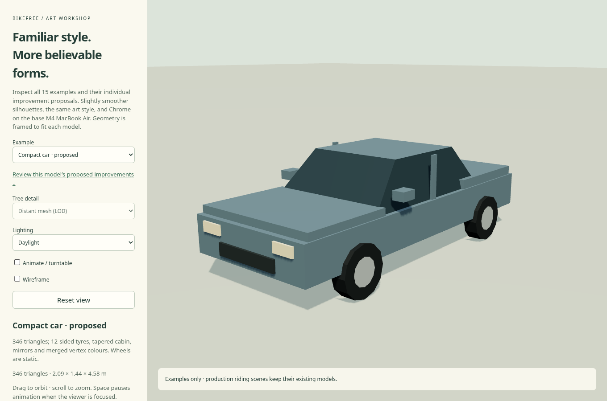

# Model realism study

Branch: `test/model-realism-study`. This is an isolated asset workshop; the riding
scenes continue to use their existing models. No downloaded art or new runtime
dependencies are required.

## View the examples

Run `npm start`, then open <http://localhost:8000/tools/model-study.html> in Chrome.
Select an asset, drag to orbit, scroll to zoom, and compare daylight with warm
evening light. Pause the turntable for silhouette inspection. Tree detail switches
between the actual near and distant meshes. Wireframe exposes the geometry cost;
the panel reports model triangles and dimensions in metres. Each asset is framed
to fit, so apparent on-screen size does not indicate relative physical scale.

The preview includes the road rider, checkered pacer, compact, SUV, camper,
cypress, pine, broadleaf, fir, palm, bench, outcrop, fern and flowers. These are the
actual bundled models. The **proposed compact** is new procedural geometry in
`tools/model-study-assets.js`: round twelve-sided tyres, a tapered cabin with
sloped glazing, mirrors, roof and lights, merged into one vertex-colour mesh.
It is a static model proposal; wheel animation, traffic light attributes and
per-instance paint masking need integration before adopting it in traffic.

## Art direction to preserve

Use slightly smoother silhouettes nearby while preserving restrained region-specific
colours, readable jersey accents, soft directional light and authored silhouettes.
Round tyre, helmet, shoulder and canopy outlines selectively; retain broad faceted
surfaces on rocks, trunks and architecture. Avoid globally subdividing the kit. Gain realism through scale,
pose, contact and material response before adding polygons or photographic
textures. Inspect at the normal chase and handlebar cameras as well as close up.

## Individual object proposals

Each of the 15 selectable examples has its own brief below and in the viewer.
These describe planned changes; only the first compact prototype is implemented.
All budgets are provisional limits per model, not measured performance results.
Near/far selection should use projected screen size and hysteresis; the distances
in review checks are inspection positions, not fixed LOD thresholds.

### Road rider

**Current example:** 26,576 triangles; articulated legs, spinning crank and wheels.

**Shape and smoother silhouettes:** Round the helmet outline and shoulder caps selectively. Refine elbow bends, glove-to-bar contact and shoe shape. Give the frame readable tube junctions, a saddle nose and a compact drivetrain silhouette; avoid smoothing the whole body or bike.

**Colour and materials:** Keep broad jersey colour blocks and matte fabric. Use restrained roughness differences for skin, helmet, rubber and frame paint; keep facial detail minimal at riding distance.

**Motion and placement:** Preserve pedal IK. Add slight breathing and effort-dependent torso motion with stable hands and hips. Check foot position, knee tracking and tyre contact through a complete pedal cycle and on grades.

**M4 Air performance budget:** Keep the near rider at or below its current triangle count by removing hidden detail before refining outlines. Prototype a 4,000-triangle cyclist for other nearby riders and a 600-triangle distant silhouette; profile animation separately.

**Acceptance checks:** Inspect chase, handlebar and side views at 0, 60 and 100 rpm, including paused and uphill poses. Reject floating hands, knee/frame intersections and exaggerated bobbing.

### Checkered pacer

**Current example:** 26,576 triangles; same rig as the rider, with a yellow-and-black jersey shader.

**Shape and smoother silhouettes:** Apply the road rider’s helmet, shoulder, glove and bicycle refinements to the shared mesh. Keep proportions consistent so the pacer reads as a fellow rider; vary helmet or socks for identity rather than duplicating the entire kit.

**Colour and materials:** Retain the yellow-and-black identity. Reduce distracting checks on narrow sleeves and test a larger chest/back pattern. Fade or simplify the checker pattern with distance to limit shimmering.

**Motion and placement:** Preserve independent cadence and road-following pose. Smooth animation during starts, stops and changes of speed; keep visual motion consistent with simulated speed and pedal rate.

**M4 Air performance budget:** Share source geometry with the rider where palettes allow; keep distinct jersey materials only where needed. Use the same proposed 4,000/600-triangle other-rider tiers and reduce rig updates at distance only if profiling supports it.

**Acceptance checks:** Compare side by side with the rider at 5, 20 and 50 m, in daylight and evening. Confirm immediate recognition, stable checks, and no visible animation snapping at LOD transitions.

### Compact car · current

**Current example:** 132 triangles; box tyres and a rectangular cabin.

**Shape and smoother silhouettes:** Replace square wheels with round tyre silhouettes, cut visible wheel arches, slope front and rear glazing, and taper the roof. Add modest bumper corners, mirrors and a readable wheelbase. Preserve the 4.5 m compact body scale.

**Colour and materials:** Separate muted body paint, dark opaque glass, rubber and lights visually. Keep the windshield distinct from paint when applying instance tints; add broad grille and lamp shapes rather than texture decals.

**Motion and placement:** Align the tyres to road grade and use correctly positioned axles. For nearby traffic, rotate wheels in proportion to speed and turn front wheels on bends; retain existing overtaking and lamp behavior.

**M4 Air performance budget:** Proposed near cap: 600 triangles, with a 150–200-triangle distant version. Keep body parts merged for instancing. Separate wheel draws only if the visual gain and measured total draw cost justify them.

**Acceptance checks:** Compare against the prototype during a 5–50 m pass from front, rear and side. Check wheel clearance, glass tint, head/tail lights, road contact and silhouette stability.

### Compact car · proposed

**Current example:** 346 triangles; 12-sided tyres, tapered cabin, mirrors and merged vertex colours. Wheels are static.

**Shape and smoother silhouettes:** Refine this first prototype with actual wheel-arch openings, softer hood corners and a less slab-like lower body. Try 16-sided tyres nearby and a small roof-edge bevel; keep the sloped windows and simple silhouette.

**Colour and materials:** Add deliberate paint/glass/rubber masks and the production aGlow light attribute. Keep lamps legible in daylight without glowing body panels at night. Retain the restrained blue-grey example paint.

**Motion and placement:** Before route integration, add correct axle transforms or a cheap wheel-motion treatment, road pose and traffic tint support. The current workshop model is a static shape study and is not yet a drop-in traffic replacement.

**M4 Air performance budget:** Allow up to 600 triangles for the next near version; preserve a merged instanced body and a 150–200-triangle far version. Compare the cost of wheel animation strategies before choosing one.

**Acceptance checks:** A/B against both the current 132-triangle car and the 346-triangle prototype. Require visible improvement at passing distance, valid night lamps, no paint tint on glass, and no route clipping.

### SUV

**Current example:** 132 triangles; shared box construction with a taller, longer cabin.

**Shape and smoother silhouettes:** Give it a distinct long roof, upright rear hatch, greater ground clearance and larger round tyres. Model wheel arches, a sloped windshield, short overhangs, mirrors and a small roof rail silhouette. Avoid simply scaling up the compact.

**Colour and materials:** Use dark lower cladding and a broad window band, with body-colour pillars and separate lamp blocks. Keep roof rails and trim in the shared muted palette; avoid shiny chrome detail.

**Motion and placement:** Set wheelbase and body height independently. Fit wheel contact to slopes without exaggerated body lean, steer nearby front wheels, and keep its larger footprint in passing-clearance checks.

**M4 Air performance budget:** Proposed near cap: 800 triangles; far cap: 200. Share the traffic shader and tyre geometry where practical, with merged static trim and no transparent window layers.

**Acceptance checks:** Compare side and rear silhouettes with the compact at 15 and 40 m. Check that tyres stay outside the body, rails do not shimmer, and the larger vehicle clears riders and barriers.

### Camper

**Current example:** 156 triangles; tall box body with a separate cab.

**Shape and smoother silhouettes:** Refine the cab windshield angle, soften the front roof edge and round the wheels. Make cab/body transition, wheel arches, door, mirrors and a restrained roof vent readable. Keep the large living box broad and simple.

**Colour and materials:** Use warm off-white body panels, a dark window band and one subdued accent stripe. Add door and storage-panel divisions with colour rather than many inset surfaces. Distinguish glass from paint tint.

**Motion and placement:** Place axles and tyre contact correctly; respect the long wheelbase and rear overhang on bends and grades. Check the roof and mirrors against bridge structures and roadside clearance.

**M4 Air performance budget:** Proposed near cap: 1,000 triangles; far cap: 250. Merge doors, vents and static trim into the body; reuse wheel geometry. No interior, transparent glazing or individual shadow-casting roof accessories.

**Acceptance checks:** Inspect uphill, downhill, parked and passing views. Check cab proportions, all four wheel contacts, overhang clearance and daylight/night lamp readability.

### Cypress

**Current example:** 1,336 triangles near / 376 distant.

**Shape and smoother silhouettes:** Create a wind-shaped asymmetric crown with two or three main lobes and a visible forked trunk. Round only the outer canopy arcs; preserve broad internal planes and a recognizably coastal, irregular silhouette.

**Colour and materials:** Keep muted olive foliage with lighter outer growth and darker inner masses. Add restrained bark colour variation and a slightly flared root base; avoid leaf cards and photographic bark.

**Motion and placement:** Place in sheltered groves and wind-exposed coastal groups with consistent prevailing lean. Keep trunk bases anchored; sway upper branches and crown tips more than the trunk, without stretching the whole tree.

**M4 Air performance budget:** Proposed near cap: 1,600 triangles; far cap: 420. Author three reusable silhouettes and instance them with bounded scale/yaw variation. Preserve major crown gaps in the far mesh.

**Acceptance checks:** Compare grove and isolated skyline views on Big Sur at 10, 50 and 150 m. Check crown gaps, root contact, restrained wind and unobtrusive near/far transitions.

### Pine

**Current example:** 1,752 triangles near / 672 distant.

**Shape and smoother silhouettes:** Expose a longer trunk, vary the height of branch tiers, and create an open crown with uneven branch ends. Smooth the outer clump profiles selectively, retaining gaps and a silhouette distinct from the denser fir.

**Colour and materials:** Use warmer bark and slightly cooler needle masses with subtle sun-facing colour variation. Keep needles represented as solid clusters; avoid individual needle geometry and transparent textures.

**Motion and placement:** Group mature pines with varied age and spacing on suitable rocky slopes. Anchor the lower trunk and use low-amplitude crown sway; avoid rotating whole trees in synchronization.

**M4 Air performance budget:** Proposed near cap: 2,000 triangles; far cap: 700. Reuse two or three branch/crown variants and keep the sparse crown silhouette intact when simplifying.

**Acceptance checks:** Check road-level trunk visibility and skyline gaps against fir at 20–150 m. Reject repeated tier spacing, overly rounded balloon crowns, and visible LOD changes in open branches.

### Broadleaf

**Current example:** 960 triangles near / 420 distant.

**Shape and smoother silhouettes:** Replace a uniform rounded crown with an offset trunk fork and several overlapping canopy lobes of different sizes. Slightly smooth the outside contour while retaining negative spaces and faceted interior shading.

**Colour and materials:** Use coherent leaf colour families with darker inner lobes and lighter new growth. Preserve regional and seasonal palettes; vary whole trees subtly rather than assigning random colours to every face.

**Motion and placement:** Place loose groups around moist valleys, settlements and lake edges. Add younger, narrower variants; use gentle branch-tip sway with different phases per instance and a stationary root base.

**M4 Air performance budget:** Proposed near cap: 1,200 triangles; far cap: 450. Start with one improved mesh and two crown variants; keep shared materials and preserve the main asymmetry in the distant silhouette.

**Acceptance checks:** Check Route 28 road views, fall colours, grouped repetition and the 960/420 baseline versus candidate at 10, 50 and 150 m. Avoid overly smooth spherical crowns.

### Fir

**Current example:** 1,944 triangles near / 504 distant.

**Shape and smoother silhouettes:** Keep the narrow tapered crown and pointed leader. Break regular cone stacking into staggered drooping branch skirts, with small edge gaps and a few visible trunk sections. Smooth branch-tip outlines rather than rounding the whole tree.

**Colour and materials:** Retain deep blue-green needles with slightly lighter tips and darker lower branch undersides. Use broad colour grouping so the tree stays readable in shadow without becoming a black cone.

**Motion and placement:** Cluster on cool mountain slopes with smaller, sparser trees near the treeline. Keep the trunk still and limit wind motion to upper branches and tips; preserve the vertical leader.

**M4 Air performance budget:** Proposed near cap: 2,200 triangles; far cap: 550. Keep current near/far savings near 75%; use a few shared branch-skirt variants and reduce ground-level density before enlarging distant geometry.

**Acceptance checks:** Compare dense forest and isolated treeline silhouettes in daylight and evening. Check leader shape, branch gaps, dark-value readability and near/far transitions against the 1,944/504 baseline.

### Palm

**Current example:** 300 triangles near / 234 distant; current distant savings are modest.

**Shape and smoother silhouettes:** Give the trunk a gentle lean and taper, a clear crown attachment and longer curved fronds with varied droop. Add a few segments along frond arcs to soften their outlines without modeling individual leaflets.

**Colour and materials:** Use warm grey-brown trunk bands and green fronds with dry lower tips. Keep opaque broad leaf forms and sparse colour variation; avoid excessive striping or glossy plastic foliage.

**Motion and placement:** Place irregular small groups on suitable coastal/island ground. Keep roots fixed and bend fronds from their attachment points, with a shared wind direction and varied phase; do not sway the entire trunk like grass.

**M4 Air performance budget:** Proposed near cap: 500 triangles; far cap: 180. Preserve the recognizable frond fan while making the distant version cheaper than the existing 234-triangle mesh.

**Acceptance checks:** Check Seven Mile Bridge views from below and against the sky. Inspect frond attachment, smoothness, underside visibility, wind deformation and distant silhouette retention.

### Bench

**Current example:** 132 triangles; one merged scenery asset.

**Shape and smoother silhouettes:** Separate seat and back into readable broad slats, add narrow visible gaps, shape the leg/support brackets and soften only exposed seat/back corners. Keep plausible seat height, depth and back angle.

**Colour and materials:** Use warm wood faces, darker end grain and muted metal supports. Add a broad sun-faded top colour and darker ground-facing surfaces rather than small scratches, screws or photographic textures.

**Motion and placement:** Seat the support feet on the overlook surface, orient the back away from the view and keep an accessible approach. Treat it as static; prevent bench placement in the riding and camera corridor.

**M4 Air performance budget:** Proposed near cap: 240 triangles; far cap: 80, or cull once slat gaps are subpixel. Merge all static parts into one instanced asset and avoid a separate material for each slat.

**Acceptance checks:** Check a bench beside the rider for human scale and inspect oblique views for gaps and supports. Verify all feet touch the ground and that slats do not shimmer at distance.

### Rock outcrop

**Current example:** 99 triangles; intentionally broad faceted stone.

**Shape and smoother silhouettes:** Create an irregular layered profile with one dominant fracture and a few secondary broken planes. Add modest bevels only on weathered exposed edges. Keep the angular geology and avoid smoothing it into a rounded lump.

**Colour and materials:** Use route-specific stone colours, darker fissures and a restrained moss/soil band near sheltered bases. Group colour by strata and exposure rather than random per-face noise; retain matte roughness.

**Motion and placement:** Bury the base into terrain and align strata consistently with nearby formations. Cluster smaller companion rocks naturally. Keep collision/road-clearance proxies conservative around projections.

**M4 Air performance budget:** Proposed near cap: 240 triangles; far cap: 100. Author three reusable fracture silhouettes, instance them with bounded transforms, and remove invisible buried faces where useful.

**Acceptance checks:** Check low road-camera views, steep slopes and evening light. Reject floating edges, repeated identical fracture patterns, road encroachment and a loss of the current broad-plane style.

### Fern

**Current example:** 210 triangles; small groundcover asset.

**Shape and smoother silhouettes:** Build a recognizable radial rosette with a few arched fronds of varied lengths, a tighter central growth point and tapered tips. Add segments along the main frond curve; suggest paired leaflets with silhouette cuts only on the closest version.

**Colour and materials:** Use a dark central stem, fresh lighter tips and restrained underside variation. Keep opaque geometry or limited double-sided leaves; avoid many overlapping transparent layers.

**Motion and placement:** Place in shaded moist pockets, around logs and sheltered rock bases. Partly bury the root point, vary orientation and frond spread, and use tiny tip motion rather than making the whole plant wave.

**M4 Air performance budget:** Proposed near cap: 300 triangles; far cap: 90, then cull when unresolvable. Use shared instanced clumps, cast no individual distant shadows, and watch double-sided fill cost.

**Acceptance checks:** Inspect from the normal elevated chase camera as well as close up. Check radial form, undersides, root contact, excessive overlap and whether extra leaflets are visible at riding distance.

### Flowers

**Current example:** 308 triangles per current flower-clump asset.

**Shape and smoother silhouettes:** Separate a few prominent blooms from supporting stems and leaves. Use shallow cupped, five- to eight-sided flower heads, varied stem heights and tapered leaves. Keep petal outlines gently rounded without adding fine botanical detail.

**Colour and materials:** Limit each regional patch to two or three related bloom colours with warm centres and subdued stems. Vary clumps coherently; reserve saturated accents for small areas rather than uniformly bright verges.

**Motion and placement:** Plant irregular patches in suitable sunny meadow/verge areas, with clear road edges and occasional gaps. Anchor stems at terrain height and sway heads slightly out of phase, with a stable base.

**M4 Air performance budget:** Proposed near cap: 400 triangles per clump; far cap: 100, then cull before flowers become flickering points. Instance clumps, disable their cast shadows, and avoid transparent petal stacks.

**Acceptance checks:** Compare close and moving verge views in daylight and evening. Check bloom readability, patch colour balance, temporal shimmer and whether the denser proposal improves the image at normal speed.

## Optimization and adoption gates

Measure before changing quality defaults. Reuse `npm run snap -- --software ...`
for repeatable visual captures and draw-call/triangle counts, and `npm run qc`
plus `npm run qc:clipping` after adopting assets in routes. Run `npm test` and
`npm run routes:check` for regressions.

For each candidate compare the same route position, time, weather, viewport and
detail level against the current version. Record frame-time median and p95,
draw calls, triangles and resource usage after warm-up. Check a dense forest,
city, bridge approach and passing vehicle. Proposed target on the documented M4
Air / Chrome platform: 60 fps Balanced (16.7 ms frame budget), with sustained
rides to expose thermal throttling. This is a target, not a measured result.

Keep the full rider rig out of distant traffic. Keep merged instanced car batches
rather than one mesh for each window/wheel. Use spatially bounded scenery batches
for culling; consider chunking traffic only if profiling its current small agent
window shows meaningful waste. Cap pixel ratio before reducing distinctive model
silhouettes. Distant LOD should save GPU work without visible popping.

## Accepted direction and benchmark plan

The user selected slightly smoother silhouettes and Chrome on the base M4
MacBook Air (interpreting “base MB Air4” as M4, 16 GB unified memory). Record the
actual CPU/GPU configuration, macOS and Chrome version with every hardware run.

First model pass:

1. Compact: retain sloped glazing; shape wheel arches and soften the hood/roof
   outline with a few additional edge segments. Try 16-sided nearby tyres versus
   the prototype's 12, preserving the single merged traffic mesh. Initial near-car
   budget: 600 triangles; compare appearance before spending the full allowance.
2. Rider: smooth helmet and shoulder contours selectively, refine elbow bends and
   hand contact, and preserve pedal IK. Do not subdivide the entire 26,576-triangle
   rider. Check the full crank cycle in chase and handlebar views.
3. Tree: start with one broadleaf variant with an asymmetric crown and slightly
   rounder outer lobes. Preserve internal faceting and the species palette.
   Initial near-mesh budget: 1,200 triangles versus the current 960; retain a
   distant mesh around the current 420 triangles and assess transition visibility.

These are proposed geometry budgets, subject to visual and hardware comparison.
Use Big Sur for the first passing-car trial and Route 28 for the forest trial;
include Pittsburgh and a bridge approach in the broader regression check.

Benchmark protocol on the physical Air:

- Run current and candidate builds with identical route positions, motion, time,
  weather, Chrome window size and quality. Use a fixed 1440 × 900 CSS viewport,
  record the effective pixel ratio/render-buffer size, and also check fullscreen
  at the laptop's normal display scaling.
- Use Balanced as the primary case, then verify Light and High. Keep power mode,
  charger state and browser workload consistent and record them.
- Warm up for five minutes, then record a 20-minute ride. Capture frame-time
  median, p95 and p99, frames exceeding 33.3 ms, draw calls and triangle counts.
  Compare the early and final five-minute windows for thermal degradation.
- Aim for 60 fps in Balanced, with p95 frame time at or below 20 ms and no recurring
  stalls above 33.3 ms. Report sustained misses and candidate-versus-current
  differences before changing defaults. These are acceptance goals, not results.
- Separate render measurements with cached/bundled resources from online terrain
  streaming; test offline reload and a real trainer session separately.

Software-rendered Chromium checks in this workspace validate appearance and
functionality only. No physical M4 Air benchmark has been performed here.

## Decisions still open
- Which biker/car references best match the intended setting? Big Sur and Route 28
  are the proposed first trial routes unless another route is preferred.
- Are cyclists exclusively road riders, or should commuter, gravel and other
  body/bike types be represented?

Only the standalone workshop and compact example are implemented here. The
broader rider, placement, LOD and lighting changes above remain proposals.

## Workshop validation

- All 17 Node test files passed, including the compact's geometry/budget check.
- Route manifest regenerated; `npm run routes:check` passed for all 11 routes.
- Expanded proposal pass: Chromium verified five individual proposal sections for
  every one of the 15 selections, matching per-object brief links, mobile flower
  brief visibility, and no page/console errors. Route checks still pass.
- Chromium with software WebGL rendered all 15 examples without console or page
  errors; also checked fir distant mesh, wireframe, warm light and mobile layout.
- Compact prototype: 346 triangles versus 132 for the current compact. These are
  geometry counts, not an on-device performance claim.

