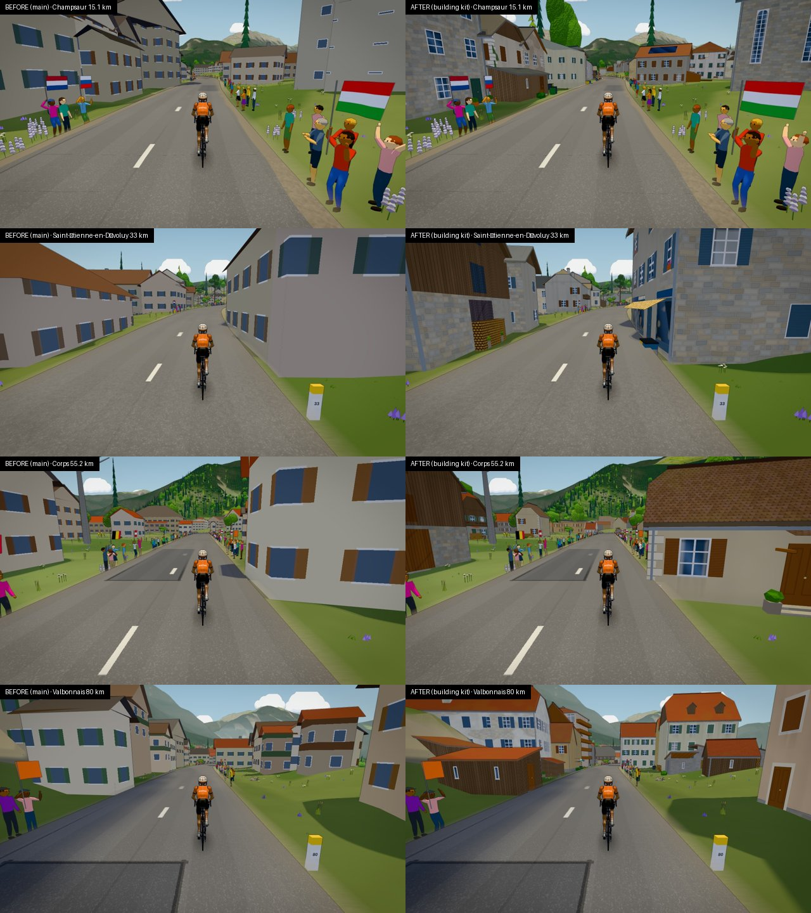
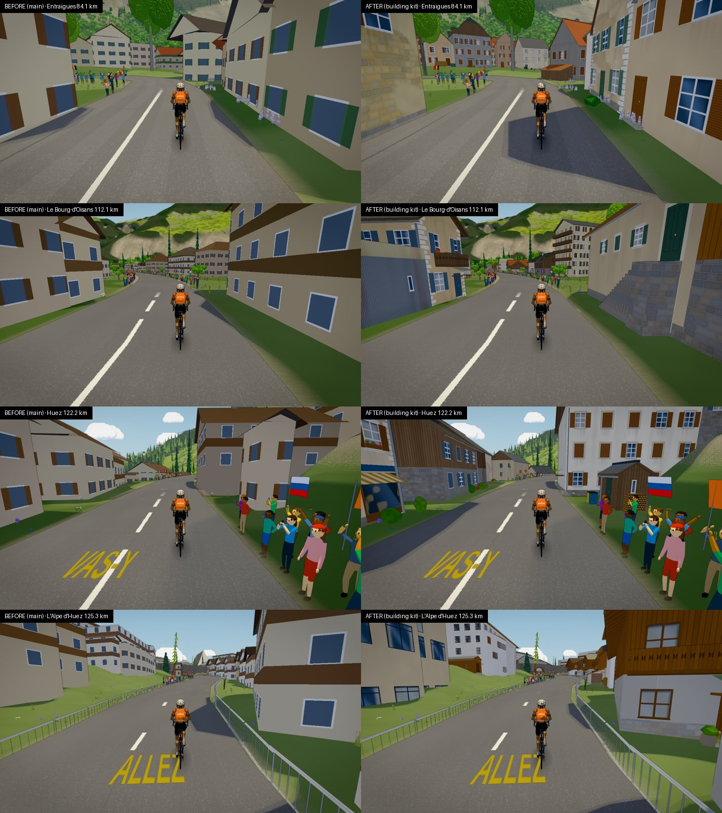
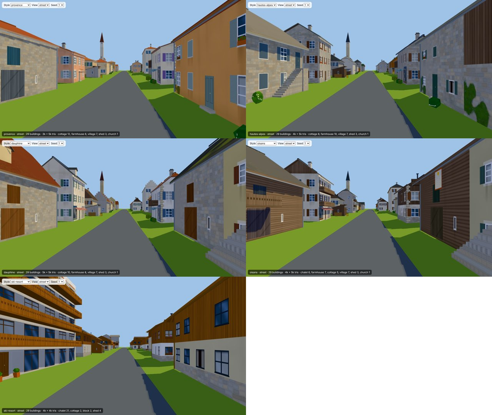
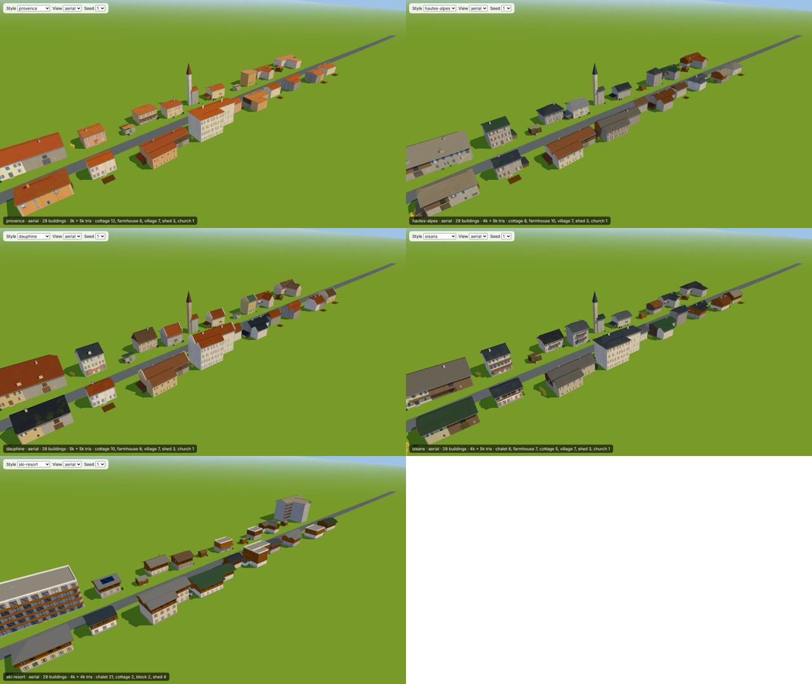
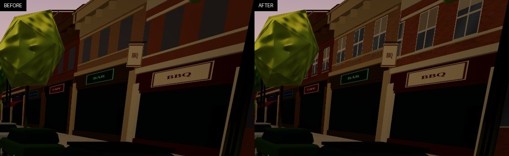
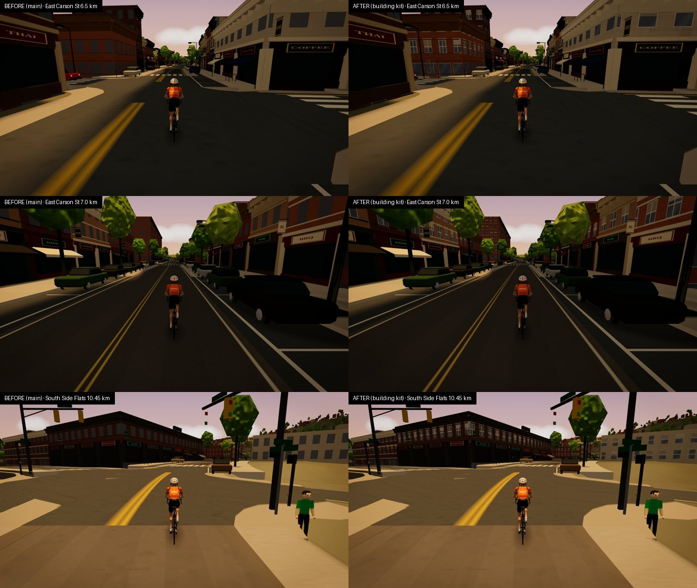
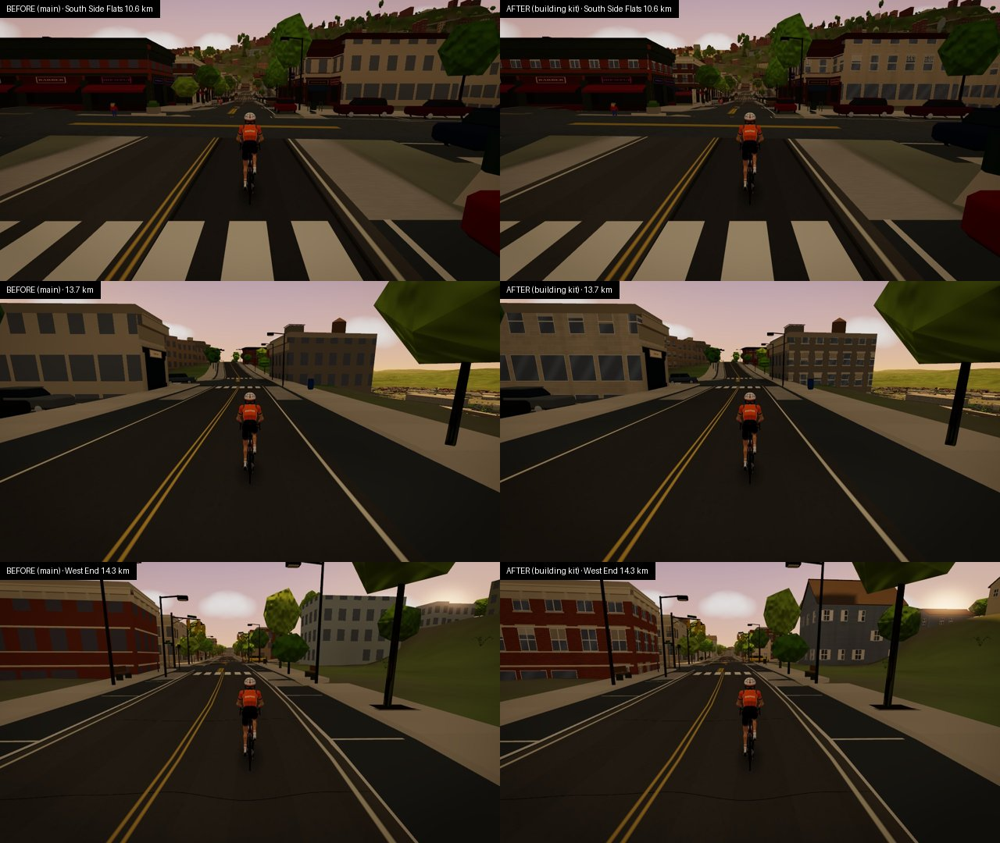
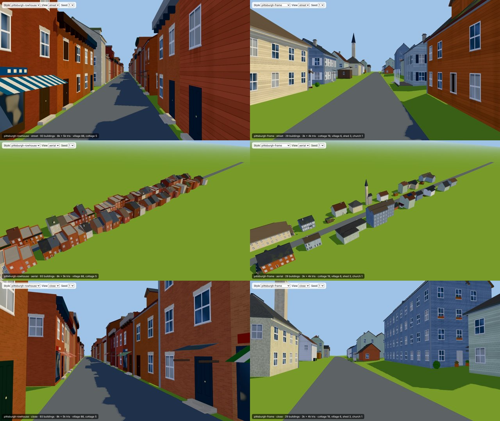

# Building kit — review (17 Nov 2026, branch `buildings-test`)

The building kit (`js/world/toolbox/structures/buildings/`, scene field `buildingKit`) on Alpe d'Huez, on top of the
map-footprint buildings. Proposals and the layer list: the Project doc `claude/building-kit-proposals.md`; how it
works: `TOOLBOX.md` → *The building kit*.

## Before and after (chase camera, Balanced, headless)

| Spot | Before: calls / triangles | After: calls / triangles |
| --- | --- | --- |
| Champsaur 15.1 km | 194 / 0.94 M | 203 / 0.99 M |
| Saint-Étienne-en-Dévoluy 33 km | 219 / 0.92 M | 223 / 0.96 M |
| Corps 55.2 km | 214 / 1.05 M | 217 / 1.08 M |
| Valbonnais 80 km | 210 / 1.04 M | 220 / 1.13 M |
| Entraigues 84.1 km | 206 / 1.13 M | 207 / 1.16 M |
| Le Bourg-d'Oisans 112.1 km | 207 / 1.07 M | 218 / 1.22 M |
| Huez 122.2 km | 221 / 1.40 M | 234 / 1.48 M |
| L'Alpe d'Huez 125.3 km | 148 / 0.86 M | 150 / 0.92 M |

Budget: under 600 calls and 2.5 M triangles on the Alpe.

## The five regional presets (`npm run gallery:buildings`)

Top left to bottom: `provence`, `hautes-alpes`, `dauphine`, `oisans`, `ski-resort`.

## What the plan makes of the Alpe's 7,129 footprints

- 66 duplicate footprints dropped (they z-fought once each copy had its own windows)
- cottage 1,904 · shed 1,704 · farmhouse 1,216 · village house 1,040 · chalet 682 · block 262 · mazot 173 · churches and chapels 31 · public 31 · the tent church
- roofs: gable 3,703 · half-hip 1,408 · shed 941 · hip 654 · crow-stepped 245 · flat 112; 949 buildings with wings (cross gables)
- extras: chimneys 3,464 · door canopies 1,075 · balconies 768 · lean-tos 664 · dormers 364 · galleries 197 · solar 195 · outside stairs 144 · garages 130 · sundials 64
- dressing: pots 1,647 · shrubs 1,314 · bins 820 · woodpiles 729 · benches 459 · gardens 358 · hay 304 · washing lines 157 · dishes 144 · troughs 26

## Open

- Load: about 1 s more than the plain extrusions (headless, 7,000 buildings). Check on the Air.
- The kit isn't on Route 28's villages or Pittsburgh's city blocks yet.

---

# Pittsburgh pass (17 Nov 2026, same branch)

**Decisions:**
- Homes get the full kit; commercial and industrial buildings get textures only; towers and heroes are untouched.
- The street kit's storefronts, cornices and bays stay.
- Pittsburgh may use 2.5 M triangles.

**What changed:**
- 8,238 homes are planned by the kit: 4,649 row houses (`pittsburgh-rowhouse`) and 3,589 frame houses (`pittsburgh-frame`).
  - 1,225 rows stand against a neighbour. Their party walls are blank and their ridges run along the street.
  - 374 of the frame houses near the route have front porches.
- Row houses that the street kit already dresses keep the city geometry. So do commercial blocks, works and the rest.
- Every city facade now gets brick, stone or metal, weathering, and real windows (frames, sashes, blinds, lintels, sills).

| Spot | Balanced before | Balanced after | High before | High after |
| --- | --- | --- | --- | --- |
| 6.5 km | 165 / 1.29 M | 176 / 1.48 M | 180 / 1.51 M | 198 / 1.81 M |
| 7.0 km | 154 / 1.19 M | 164 / 1.37 M | | |
| 8.8 km | 267 / 1.79 M | 290 / 2.06 M | 284 / 1.98 M | 307 / 2.24 M |
| 10.45 km | 188 / 1.30 M | 196 / 1.49 M | 197 / 1.54 M | 207 / 1.82 M* |
| 13.7 km | 214 / 1.23 M | 222 / 1.31 M | | |
| 14.3 km | 224 / 1.05 M | 229 / 1.09 M | | |
| 17.3 km | 287 / 1.65 M | 308 / 1.86 M | 322 / 1.95 M | 343 / 2.16 M |

\* measured before the far-tier trims (soffits, fascias and chimneys only near the route), so it is now lower.

**Clipping QC:** 0 fail, 70 warn, the same findings as main. Lamps and street trees keep clear of the kit's eaves, porches and dressing.

**Open:** ride on the Mac and the Air; load is about 1 s slower (headless) while 8,200 homes are planned.
