# Going-to-the-Sun Road · hero review

Branch `goingtothesun-test`, from `main` after PR #17 (Pittsburgh). The plan and decisions are in the Going-to-the-Sun section of `PLAN.md`.

*All shots are rendered with a software GPU in headless Chrome (`npm run snap -- --software`). Light and colour are close to what you'll see on the Mac, but frame rate isn't.*

Fixed spots (outbound metres, new 75.5 km route from Apgar):

| Spot | Metres |
| --- | --- |
| Lake McDonald east shore | 6000 |
| Avalanche Creek | 22300 |
| Garden Wall, below Haystack | 40000 (drone 44000) |
| Logan Pass | 47300 |
| Siyeh Bend | 51500 |
| Jackson Glacier overlook | 55500 |
| St. Mary Lake, Wild Goose Island stretch | 63000 |
| St. Mary | 75000 |

## P1 · Road

- The route now covers the whole road: **Apgar → Lake McDonald Lodge → Avalanche → the Loop → Logan Pass → Siyeh Bend → Sun Point → Rising Sun → St. Mary**, 75.5 km each way (151 km lap). The old route started at Lake McDonald Lodge and turned at Logan Pass.
- Checked against the OpenStreetMap map: the track follows the real road, including the Loop hairpin and Siyeh Bend.
- Road profile re-fitted to the real 10 m ground: max grade 8.5% (the real road is about 6–7% at most), 1.6 m mean from the ground. Climb 1,884 m per lap.

## P2 · Baseline (before any hero work)

| Lake McDonald (6 km) | Avalanche Creek (22.3 km) |
| --- | --- |
| 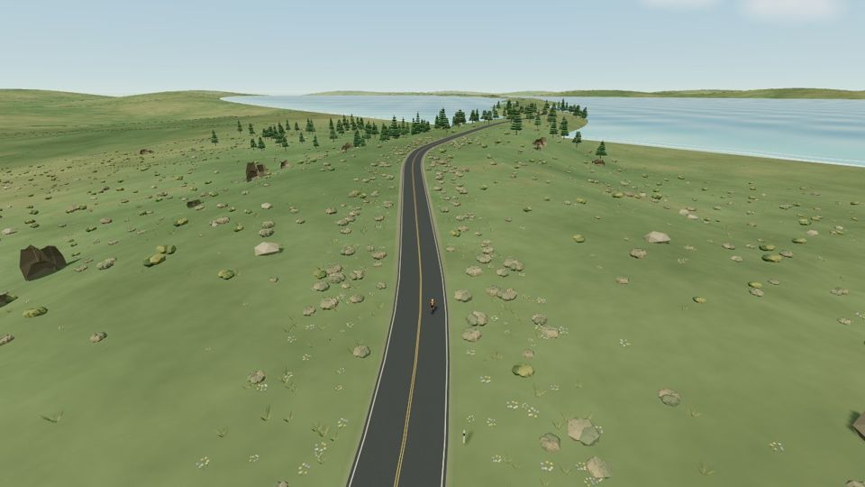 | 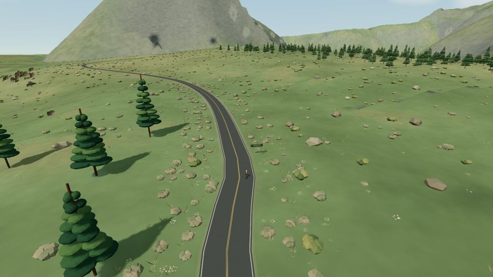 |
| **Garden Wall (40 km)** | **Logan Pass, golden hour (47.3 km)** |
| 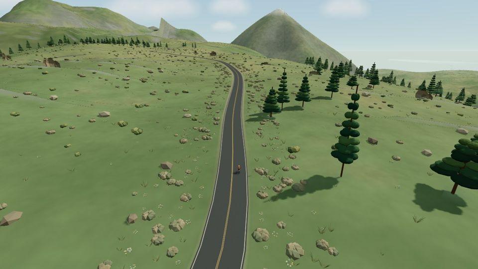 | 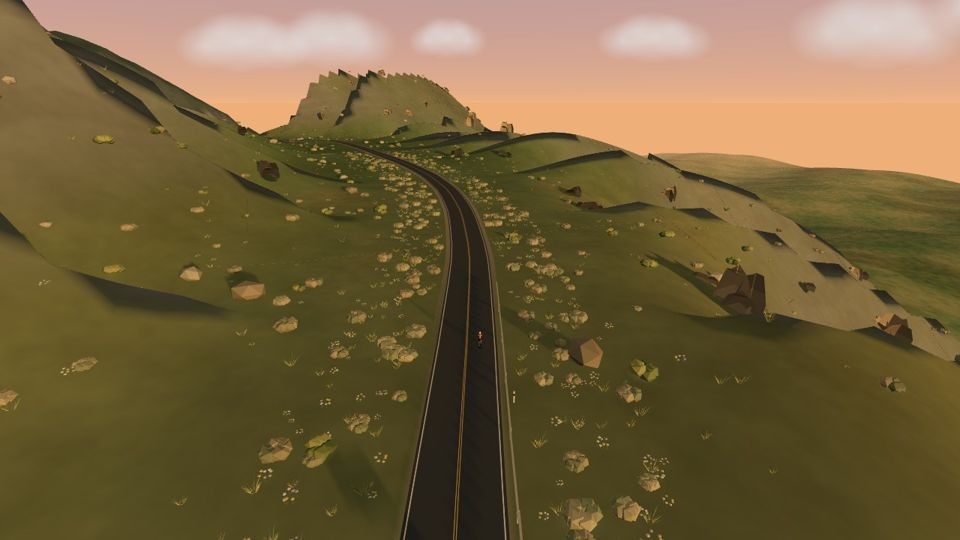 |
| **St. Mary Lake (63 km)** | **Night below the pass (45 km)** |
| 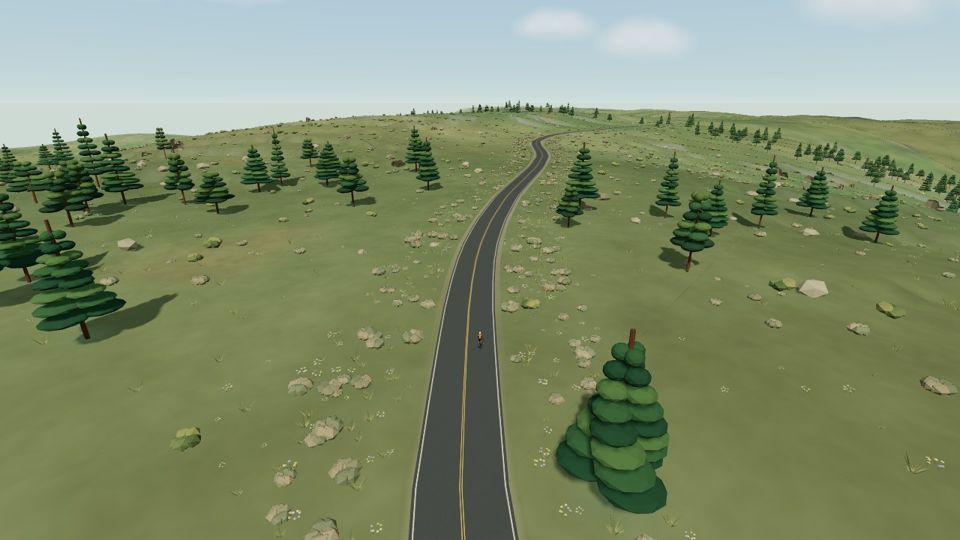 | 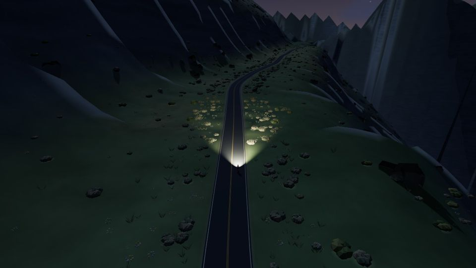 |

**Measured problems**
- **Landform is invented.** Three dome "formations" (Heavens Peak, Mount Cannon, the Logan Pass ridges) on 100 m of rolling relief. The real road climbs 1,050 m up a glacial trough under 2,500–3,000 m walls; here the Garden Wall is a green lawn.
- **Water:** Lake McDonald is a 1.6 × 5.2 km ellipse (real: 16 km × 1.6 km, 2,760 ha); St. Mary Lake is missing.
- **Vegetation:** about 15–30 trees per hectare as parkland, three generic species. The real west side is closed cedar–hemlock forest (180+ per hectare); the east side is aspen groves and grassland.
- **No rock, no snow, no strata:** Glacier's red and green argillite and the grey limestone with the dark sill band are its signature colours.
- **Nothing built:** no stone guardwalls, tunnels, arches, lodges or the Logan Pass visitor center.
- **Atmosphere:** midday, flat; no weather beyond the generic presets.
- **Budget at baseline** (Balanced): 270–362 draw calls, 0.76–1.43 M triangles.

Second pass (re-measured from the data, not the pictures): the baked lake list confirms Lake McDonald at 962 m and St. Mary Lake at 1,368 m (the authored lake sat at 960 m), and the old GPX's elevation was smoothed over 800 m windows, flattening the Loop and the Siyeh Bend grades.

## P3 · Real landform and lakes · P6 · Forest (first pass)

| Lake McDonald (6 km) | Avalanche Creek (22.3 km) |
| --- | --- |
| 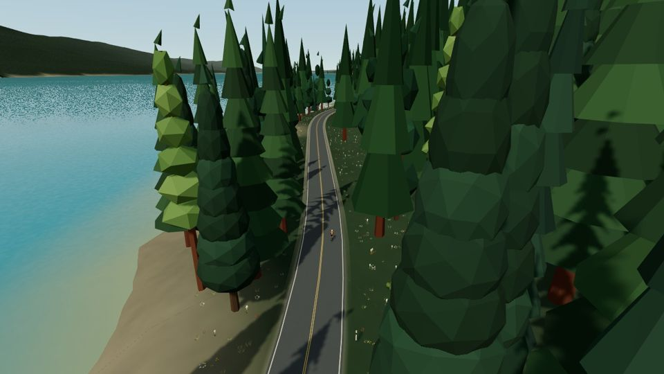 | 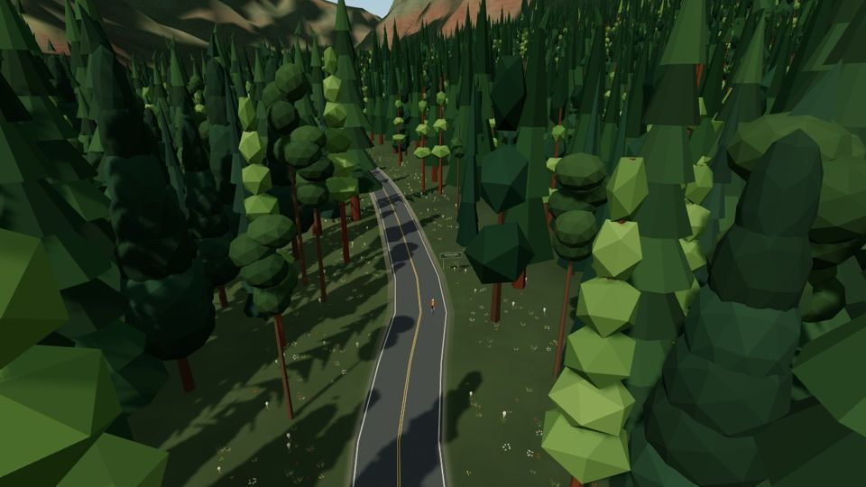 |
| **Garden Wall (40 km)** | **Logan Pass, golden hour (47.3 km)** |
| 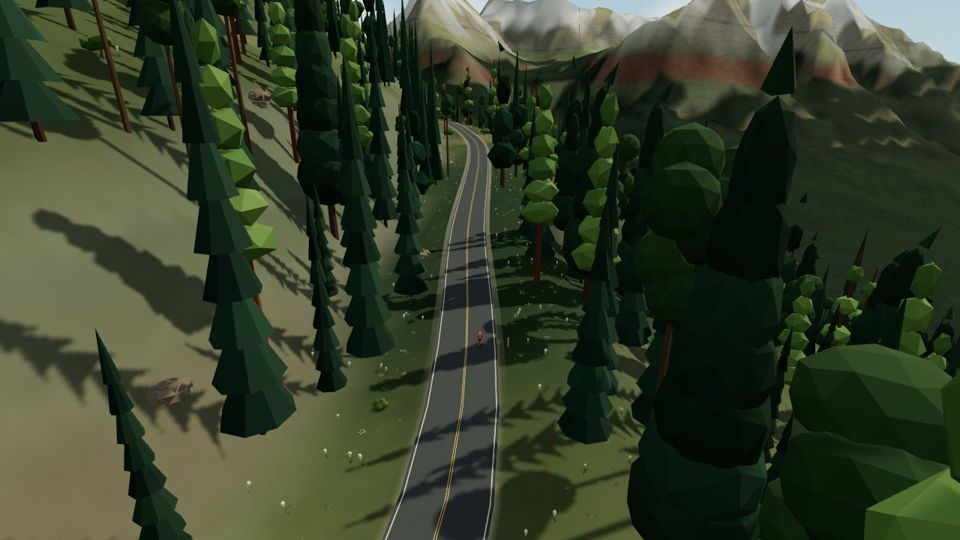 | 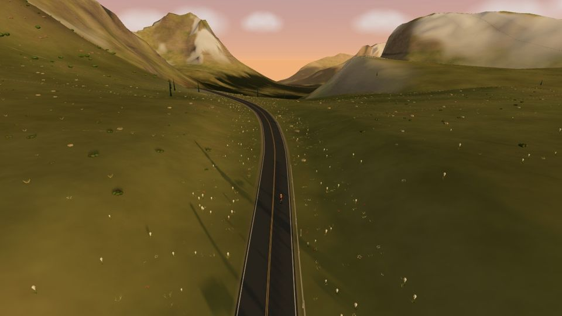 |
| **St. Mary Lake (63 km)** | **Garden Wall from above (44 km)** |
| 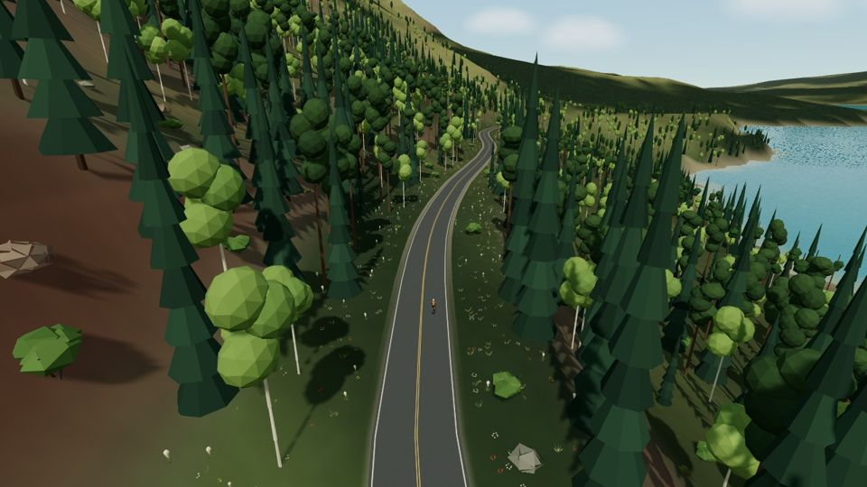 | 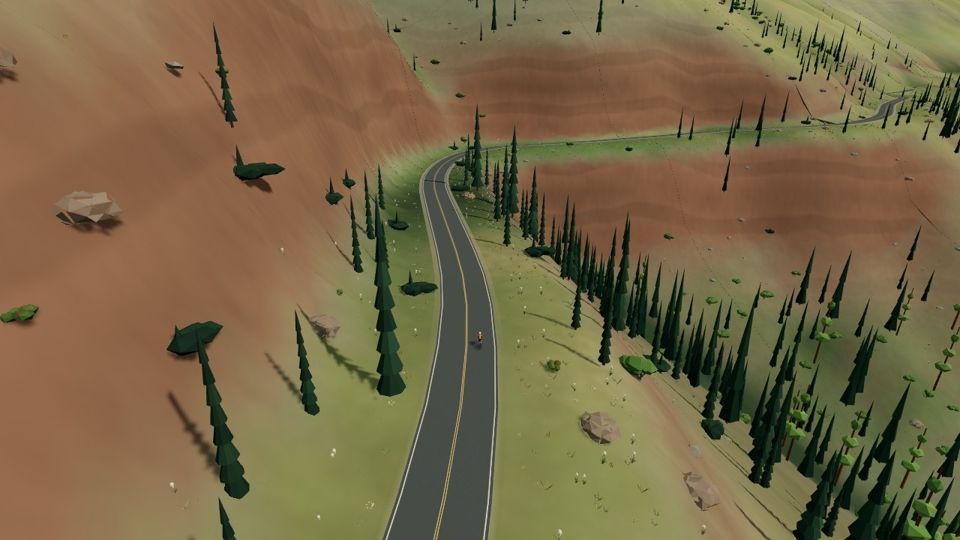 |

- **Terrain:** `routes/scenes/goingtothesun-terrain.json` from `tools/build_terrain_grid.py` (new inland **"lakes" mode**): 10 m within 900 m of the road, 40 m out to 9 km (941–3,082 m). 86 hydro-flattened lakes found from the elevation, each at its own level: Lake McDonald 962 m, St. Mary Lake 1,368 m, Lower St. Mary, Hidden Lake and others.
- **New landscape `real-mountain`** (in `real-coast.js`): Big Sur's real-terrain pipeline without a sea — lakes from a 20 m lake-id raster with their own levels, lake beds and shallows, creeks that end in a lake, the shoreline field for lake shores.
- **Rock:** the cliffs show the park's formations by elevation — red and green argillite, grey limestone above 1,900 m, the dark sill band at about 2,120 m — and midsummer snowfields in the cirques and on the north faces.
- **Forest:** a new procedural **Glacier kit** (`js/world/glacier-kit.js`, three levels of detail): western red cedar, western hemlock, Engelmann spruce, subalpine fir, western larch, lodgepole pine, aspen, krummholz; beargrass, paintbrush, glacier lilies, huckleberry, Sitka alder, talus. Placed by Route 28's tiered forest planner, with species and density from the landform: cedar–hemlock in the west-side valleys, spruce–fir–larch on the slopes, krummholz at the treeline (≈1,950 m, lower on the east side), aspen and lodgepole on the dry east side; avalanche chutes and cliffs stay open.
