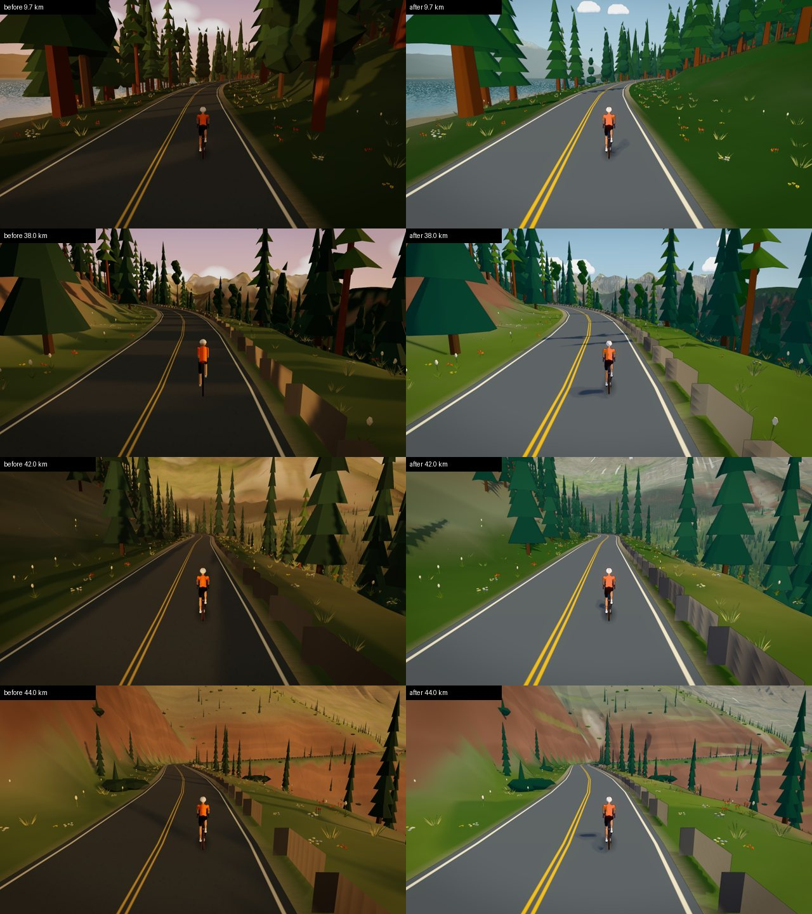
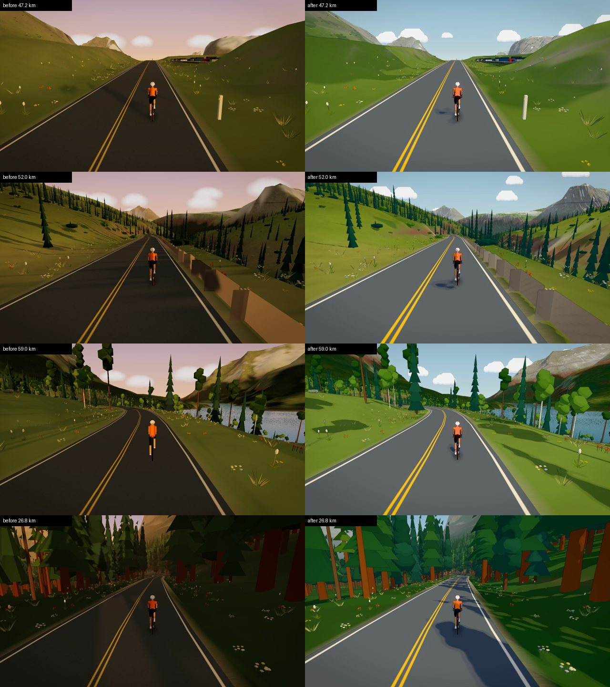
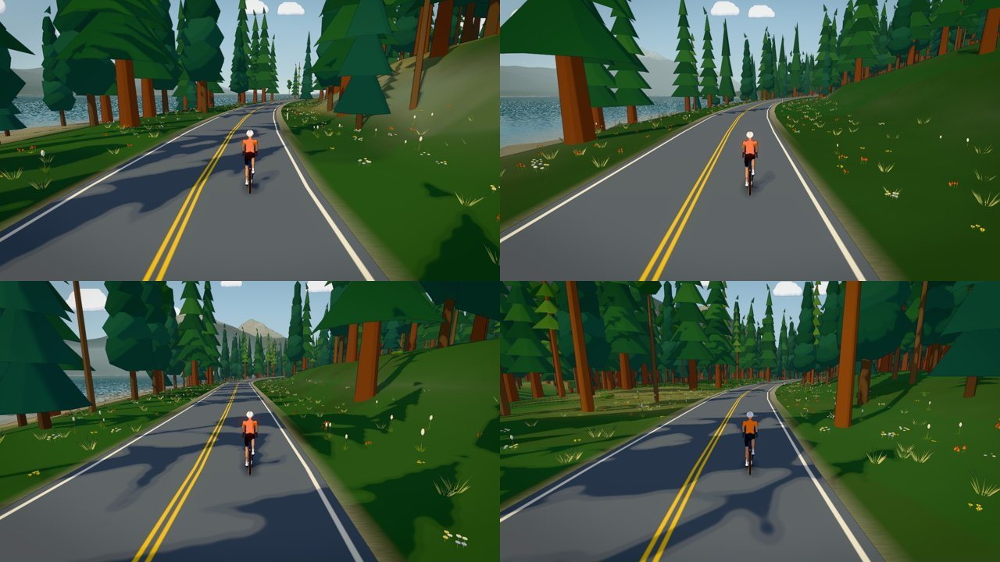
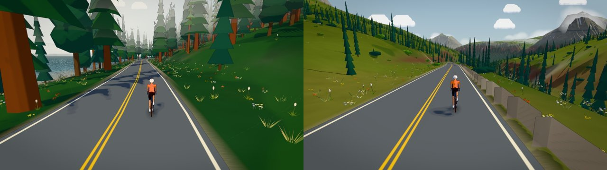

# Going-to-the-Sun: vista kit pass

Branch `goingtothesun-visual-test`. Decisions and the to-do list are in PLAN.md → *Going-to-the-Sun visual pass*. How to use the kit on another route is in ROUTES.md → *Vista kit*.

All pictures are headless snapshots (`npm run snap`) on Balanced from the chase camera. "Before" is `main` (golden hour, no cartoon). "After" is this branch (cartoon gentle at midday, with the vista kit).

| | |
|---|---|
|  |  |

- **Mountain faces** (52 km, 59 km): gullies and spurs run down the faces and catch the light. The spurs are lighter rock, the gullies hold snow or loose rock, and narrow broken ledges appear within about 1 km.
- **Depth** (38 km, 42 km): ridges fade toward a pale blue, more in the low air than on the tops, so each range separates from the one behind. Far ridges get a faint outline.
- **Meadows** (47 km): shrub patches and a slow colour drift replace the even green carpet.
- **Sky:** flat-bottomed cartoon cumulus sits among the peaks.
- **Valley** (9.7 km): every ~850 m the trees between the road and Lake McDonald open for a view across the water.

The weather presets kept are clear, valley fog and clouds on the peaks:

## Cost (Balanced, headless)

| Spot | Draw calls main → branch | Triangles main → branch |
|---|---|---|
| 9.7 km | 318 → 308 | 1.73 → 1.72 M |
| 26.8 km | 346 → 344 | 2.02 → 2.09 M |
| 38.0 km | 357 → 353 | 1.90 → 1.99 M |
| 42.0 km | 287 → 283 | 1.77 → 1.77 M |
| 44.0 km | 310 → 310 | 1.77 → 1.78 M |
| 47.2 km | 244 → 244 | 1.59 → 1.59 M |
| 52.0 km | 267 → 267 | 1.61 → 1.61 M |
| 59.0 km | 230 → 232 | 1.59 → 1.65 M |

- **Draw calls:** none added. The ceiling is 450.
- **Triangles:** up to 4% more, from the denser outer forest tiers.
- **Ground shader:** heavier, at about 40 value-noise lookups per pixel on mountain faces. The rock work is skipped on flat ground, and every detail fades to its average once it's smaller than about two pixels.
- **Still to do:** a ride on the M4 Air with the `I` overlay. If it's over budget, drop `rock.ledges` or `meadow` first.
