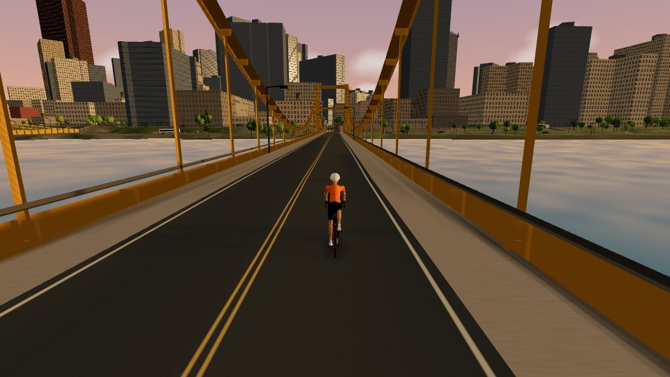
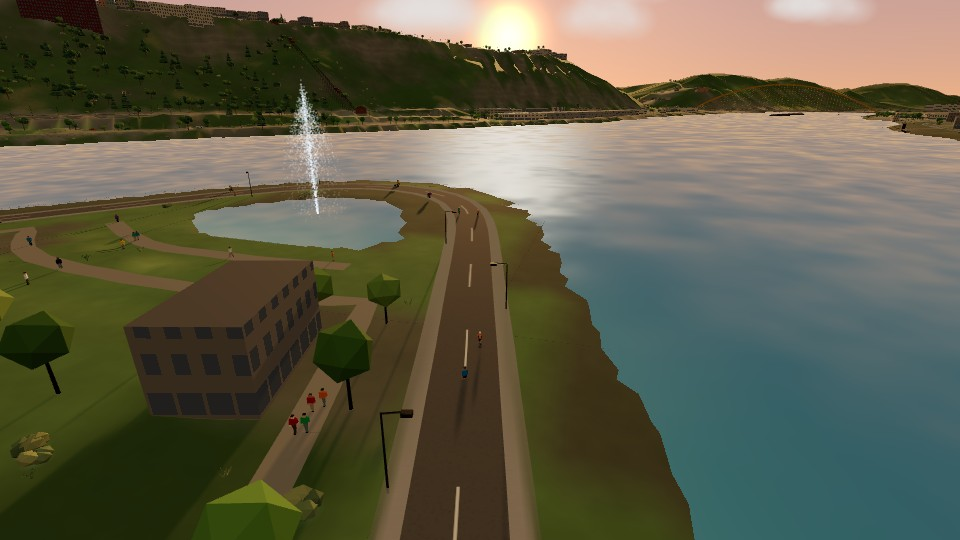
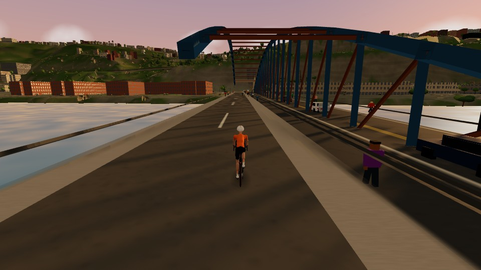
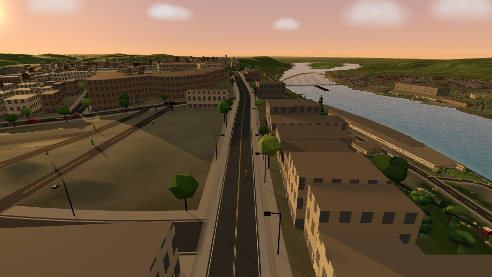
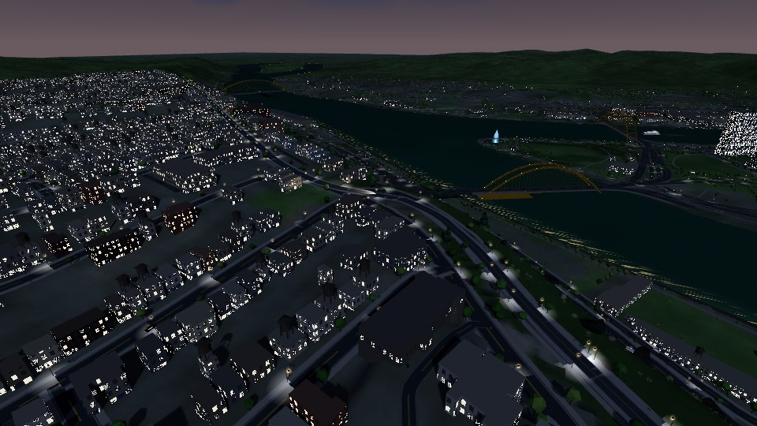
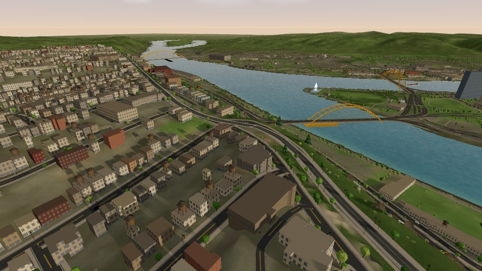
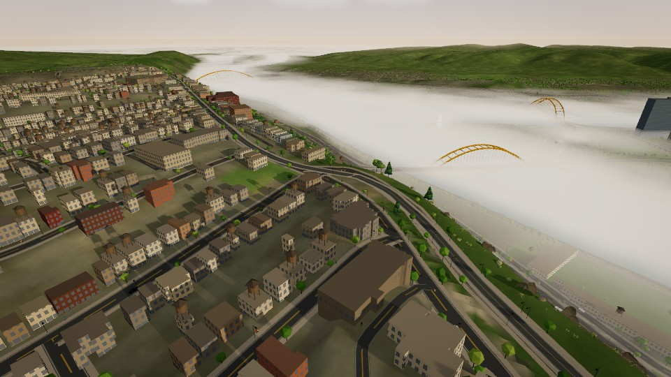
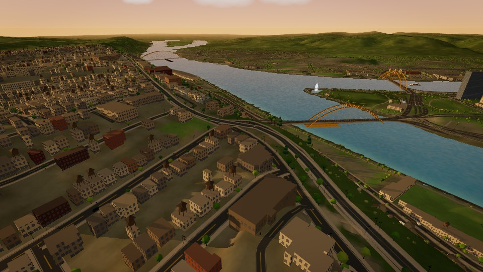
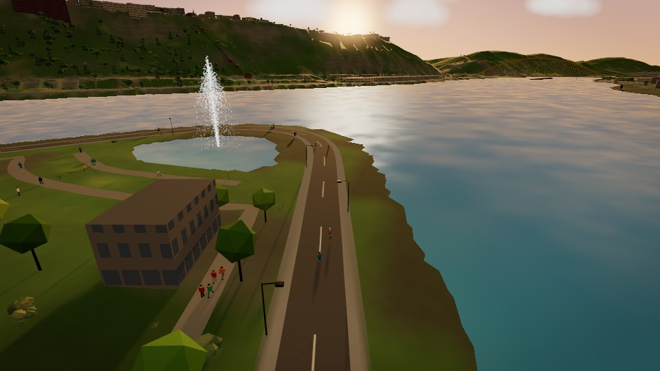

# Pittsburgh · hero review

Branch `pittsburgh-test`, built on v0.12.2. The plan is in the Project doc *open-items-and-pittsburgh-hero-plan* and in the Pittsburgh hero section of `PLAN.md`.

*All shots are rendered with a software GPU in headless Chrome (`npm run snap -- --software`). Light and colour are close to what you'll see on the Mac, but frame rate isn't.*

## P1 · Baseline (v0.12.2, before any hero work)

| Clemente Bridge into downtown (0.8 km) | The Point and the fountain (1.8 km, drone) |
| --- | --- |
|  |  |
| **Truss bridge (4.3 km)** | **Hillside above the rivers (11.5 km)** |
|  |  |
| **Night over the North Side (13.1 km)** | **"Marine layer" before P2 (13.1 km)** |
|  |  |

**What reads well**
- The three gold suspension bridges, the river at the Point, the fountain and the night lights.
- Street life: traffic, people and trains already give way to the rider (v0.12.1).

**What doesn't read as Pittsburgh yet**
- **Downtown:** generic glass boxes. PPG Place, the U.S. Steel Tower and Fifth Avenue Place aren't recognisable, and the skyline has no silhouette.
- **The Point:** a lawn with a fountain. There's no Fort Pitt outline, no portal bridge, and no sense of the three rivers meeting.
- **Mount Washington:** a gentle green slope. The real bluff is steep, wooded, and has the inclines and the Grandview overlooks along its edge.
- **North Shore:** the stadiums are missing, so the riverfront west of the bridges is empty ground.
- **Industrial riverfront** (11.5–14 km): repeated tan boxes with no rail yards, stacks or loading docks.
- **Atmosphere:** the default is midday with flat light; the weather offered Big Sur's "Marine layer", which buried the whole river valley in an opaque bank 150 m deep (above).
- **Water:** flat, with no barges and only one boat.

**Budget at baseline** (draw calls / triangles, Balanced): 315–578 calls and 0.82–1.56 M triangles. The hillside at 11.5 km (578 calls) is closest to the 600 budget, so new landmarks need to come in as merged meshes, not as extra objects.

## P2 · Atmosphere (done)

| River fog: lies on the water, the bridges stand above it | Golden hour is now the route's default |
| --- | --- |
|  |  |
| **The Point with post-processing (bloom on the low sun and the fountain)** | |
|  | |

- **Golden hour by default:** Settings › Time of day has a new first option, *Route's default*, and it's now the default. Pittsburgh's default is golden hour; other routes keep midday. A saved *Midday* (the old default) moves to *Route's default* once; anything else you picked stays.
- **River fog:** Pittsburgh offers *Clear*, *River fog* and *Clouds* (no rain, as decided). The fog is low and thin. It sits on the three rivers at water level, about 30 m deep, so bridge arches and the city rise out of it, and it doesn't spill into the streets. **W** cycles only the presets the route offers. A saved weather the route doesn't offer falls back to *Clear*.
- **Post-processing** is on, as on Big Sur: HDR, soft bloom, a gentle grade and a vignette. It's off on Light detail.
- **How it works:** the city now builds a distance-to-river field on its height grid. The fog uses that field (in place of Big Sur's distance to the shore) and is measured from the river level, not from sea level. Scenes can set `weather.presets`, `weather.labels`, `weather.bankTop` and `weather.bank` (fog thickness), plus `timeOfDay`.
- Draw calls and triangles are unchanged within ±10 (fog layers and post add a few passes).

## Still to check on the Mac
- Frame rate with post and river fog on Balanced and High (**I** overlay).
- River fog from the saddle on the bridges: you should ride out of it as you climb.
