# S1 · North Shore → Clemente Bridge → the Point → Mon Wharf (0 – 2.7 km), and baked lighting

Branch `pgh-s1`. Section agent S1 of the Pittsburgh detail pass (see `BRIEF.md`).

## What changed

| | Where | What |
| --- | --- | --- |
| **Baked lighting** (shared) | `js/world/baked-light.js` (new), hooks in `world.js`, `snap_scene.mjs`, `snap_cam.mjs` | Fixed golden-hour sun; sun shadows and ambient occlusion for all static scenery baked once on the GPU at load; the live shadow map keeps only moving things. On for the whole Pittsburgh route (`"lighting": {"baked": "golden"}`) |
| **Riverfront promenades** | `js/world/riverfront.js` (new), hooks in `city-landscape.js`, `city.js`, `qc_course.mjs` | Along the Allegheny riverfront trail, round the Point and along the Mon promenade / Mon Wharf (1.13 – 2.29 km and 2.46 – 2.78 km): a paved walk, a lawn where it is wide, a granite edge strip, a pale coping, a dressed-stone river wall with a wet band into the river, a black railing and benches facing the water. The map's sawtooth grass bank is gone: the ground past the wall is pushed under the water |
| **North Shore Water Steps** | `js/world/riverfront.js` (`waterSteps`) | Ten granite tiers from the plaza (5 m over the river) down to the start, with a sheet of water on each tread and a white fall over each riser, granite cheek walls, the ground carved under them |
| **Stadium walls** | `city-bridges.js` `[s1-stadium]` | The stadiums' outer walls were one blank quad per segment, wound one way whatever the outline's winding, so the face toward General Robinson St could face inward and read as a huge dark slab. Now each bay faces out: a stone plinth, tall dark openings between pilasters, a darker steel upper level, a pale cornice |
| **Lane paint** | `city.js` `[s1-lanes]` | The street texture has three paint styles: two-way (double yellow centre), one-way multi-lane (yellow left edge, dashed white lanes) and one-way single lane (ramps: edge lines only); one-ways no longer carry a double yellow line down the middle |

## Pictures

Golden hour, Balanced, software GPU, 960×540. *Before* = `pittsburgh-detail-test` (eba1746), *after* = `pgh-s1`.

Chase camera (what the rider sees), before | after:

| | |
| --- | --- |
| 0.3 km General Robinson St, PNC Park on the right | 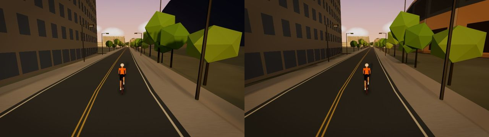 |
| 0.65 km Federal St to the Clemente Bridge | 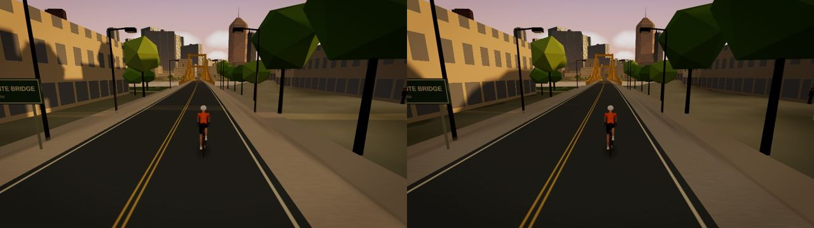 |
| 1.6 km Allegheny riverfront, Point State Park | 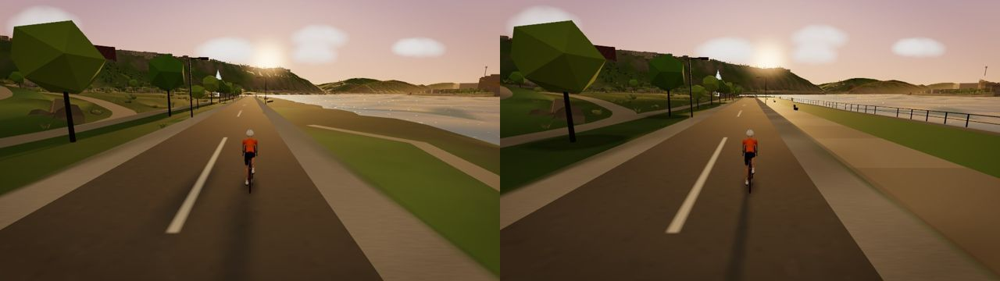 |
| 1.93 km the tip of the Point | 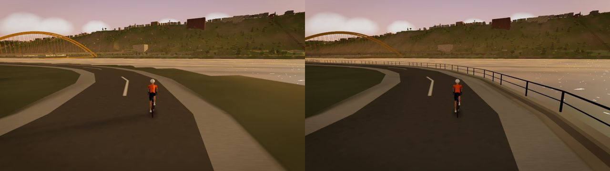 |
| 2.5 km Mon Wharf | 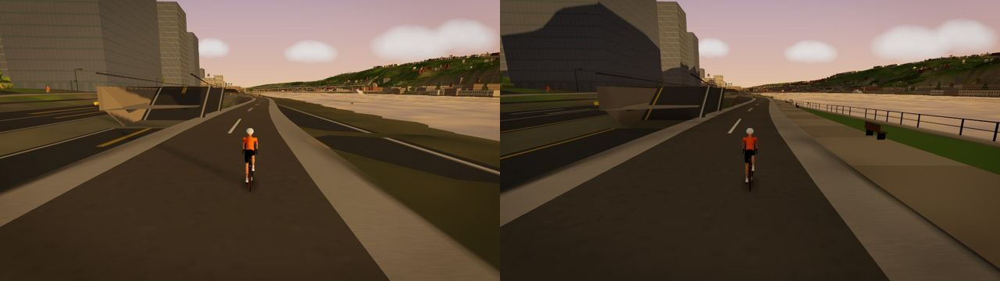 |
| 2.5 km at night | 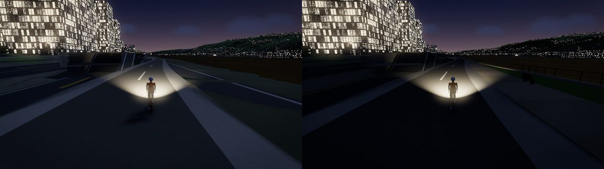 |
| 18.27 km (the start / finish): the Water Steps and PNC Park | 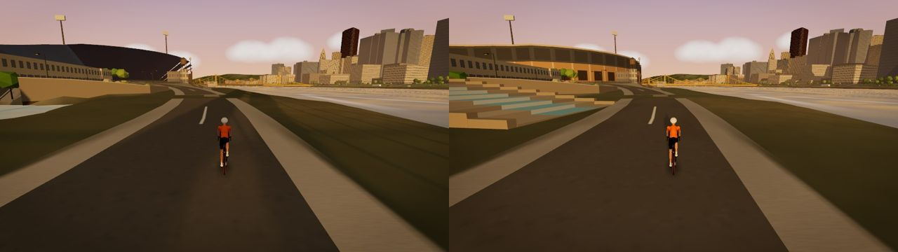 |

The before chase shots were taken without first building every city chunk, so a few far buildings are
missing from them; the after shots (baked) build them all.

`npm run snap` default camera, baseline (`/home/claude/baseline`, 1280×720) | after: the stadium slab at
0.3 km is now a lit, bayed wall.

| | |
| --- | --- |
| 0.3 km | 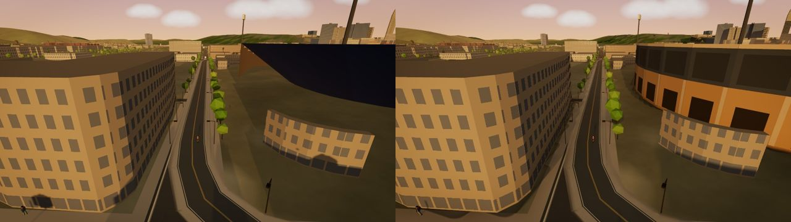 |
| 0.65 km | 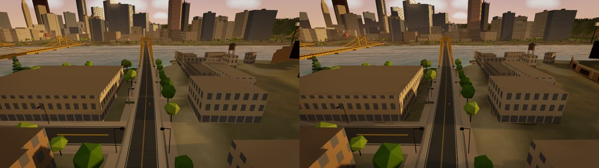 |
| 1.6 km | 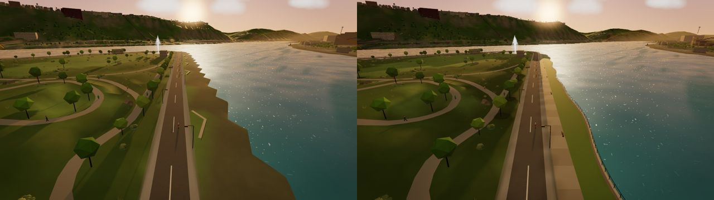 |
| 2.5 km | 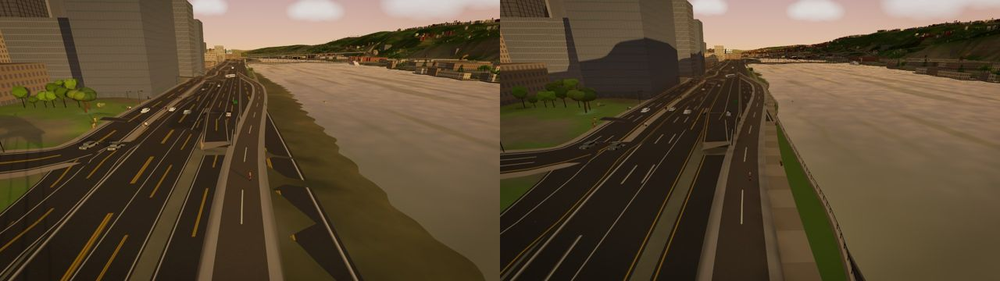 |
| 1.6 km at night (after) | 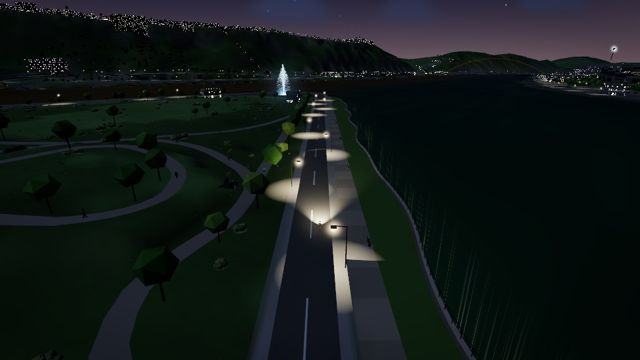 |

## Numbers

**Shadow pass and frame, chase camera, Balanced**, same page, every city chunk built, live shadows vs baked
(`renderer.info`, the whole frame incl. post and the shadow pass):

| spot | frame calls live → baked | frame triangles live → baked | shadow pass calls | shadow pass triangles |
| --- | --- | --- | --- | --- |
| 0.3 km | 391 → 368 | 1.07 M → 0.82 M | 45 → 22 | 314 k → 67 k |
| 0.65 km | 564 → 543 | 1.49 M → 1.27 M | 47 → 26 | 300 k → 73 k |
| 1.6 km | 330 → 300 | 1.14 M → 0.87 M | 55 → 25 | 332 k → 68 k |
| 2.5 km | 557 → 527 | 1.41 M → 1.15 M | 57 → 27 | 329 k → 78 k |

The shadow pass loses about half its draw calls and three quarters of its triangles (only moving things in a
42 m box). Software-GPU frame times on this shared 2-CPU machine are noise and not reported; measure on
the M4 with the **I** overlay.

**The bake** (SwiftShader, 2 shared CPUs): work grid 3618 × 1650 at 2.5 m, view grid 2640 × 1442, 696 static
meshes, 11 sweep passes. Re-bake (warm): **92–104 ms** in total, worst single step 36 ms, terrain samples
cached. The first bake: 3.0–9.4 s on SwiftShader, almost all of it the first occluder draw (compiling the
occluder programs and uploading every static mesh of the route); the ground samples take 15–26 ms, the 11
GPU passes 60–100 ms. Persistent GPU memory 18 MB (RG16F shadow height + R8 AO); the bake briefly holds about
80 MB of work targets. Chosen: **bake once at load** (no committed data, always matches the scenery).

**`npm run snap`** (default camera, after): 363 / 538 / 309 / 540 calls and 0.83 / 1.26 / 0.87 / 1.12 M
triangles at 0.3 / 0.65 / 1.6 / 2.5 km; night at 1.6 km 321 calls. The baseline's 311 / 452 / 316 / 403 are
lower because the snapshot tool drew before the city had streamed in every chunk; `bakeNow()` builds them all
first, so these are the honest numbers (and the live-vs-baked table above is the like-for-like one).

**QC**: `npm test` 99/99 (new `test/riverfront.test.mjs`); `npm run qc -- pittsburgh --strict` 0 fail 0 warn;
`npm run qc:clipping -- --no-life` **0 fail, 86 warn** (baseline 91): floating 3, ground-over-street 58, post-in-solid 18, structure-through-building 1, z-fight 6 (was 11); info buildings-overlap 9, sunk 46. Nothing new from the promenade or the steps.

## Baked lighting: design and how-to

### Design (bake once at load, on the GPU)

A scene that opts in gets a fixed sun (the baked time of day). When the static scenery has finished streaming
in, `BakedLighting` bakes, in a few small steps spread over frames:

1. **Column tops**: an orthographic render, straight down, of every static mesh (terrain sampled on a 16 m
   grid, buildings, bridges, streets, decks, trees, props) into a half-float target: the height of the top
   of whatever stands in each 2.5 m column. A 2×2 opening drops sub-texel things (cables, rails, sign arms).
2. **Shadow height**: a sweep toward the sun, doubling the reach each pass (11 passes reach 2.5 km for the
   golden-hour sun at 7°): `S(p) = max_j (top(p + j·sunstep) − j·cell·tan(elev))`. A point at height `y` is in
   sun when `y > S(p)` (with a soft edge). This one map shadows walls, roofs, the rider and the traffic at
   any height, and golden-hour shadows reach as far as they really do (the live map covered ~100 m).
3. **Ambient occlusion** from the column tops (8 directions × 4 radii): street canyons, wall feet, under
   decks and crowns.

Every lit material (standard, lambert, phong) is patched once (chained `onBeforeCompile`, like `look.js`):
the sun's direct light is multiplied by the baked visibility *before* the lighting model, and the sky light
by the AO. A toon / banded look reads it like the shadow map, so the cartoon look on
`origin/route28-cartoon` can sit on top of it (not adopted here). The live shadow map stays on (Balanced,
High) for moving things only (rider, traffic, people, boats, cyclists, incline cars) in a 42 m box round
the rider; static meshes stop casting into it once the bake is in. At night the sun shadow is off and the
AO stays.

**Why not an offline bake**: the bake is fast (numbers above) and always matches the scenery; a committed
bake would be 2640 × 1442 texels (≈ 2–4 MB as a quantized PNG) per time of day, and stale after every city
rebuild.

### Switch it on for a route

```json
"lighting": { "baked": "golden" }
```

in the scene JSON. Optional keys (defaults in `BAKE_DEFAULTS`):

| key | default | |
| --- | --- | --- |
| `baked` | – | the baked time of day: a `TIME_PRESETS` key (`golden`, `morning`, `midday`); other times show it, `night` stays night |
| `sun` | the preset's | `{ "elev": 7, "az": 258 }` to override |
| `cellM` | 2.5 | texel size; grows to fit `maxTexels` (9 M) and the GPU's texture size |
| `marginM` | 500 | baked area: the route's bounding box plus this (outside it, nothing is shadowed) |
| `reachM` | 2500 | how far up-sun occluders count |
| `soft`, `bias`, `normalOffset` | .55, .35, 1.4 | shadow edge (m of height), bias (m), lookup offset along the normal (texels) |
| `ao`, `aoFadeM`, `cover` | .62, 9, .45 | AO strength, AO fade height above the surface below, extra sky-light loss under a deck or crown |
| `dynamicSpanM` | 42 | half-size of the live shadow box for moving things |

For scenery code:
- Static meshes need nothing. Thin things (< 0.9 m across in plan and over 1.2 m tall: posts, poles, lamp
  arms) are left out of the bake (they would rasterize as random pillars); `userData.bake = true` forces a
  mesh in, `userData.bake = false` keeps it out (use it for LOD detail that streams with the camera, so it
  doesn't trigger re-bakes).
- Moving meshes: `userData.dynamic = true`, or an `InstancedMesh` with `DynamicDrawUsage`, or skinned: they
  keep casting into the live map. Pooled plants (`userData.pooled`) are left out of the bake and keep
  casting live.
- Re-bakes: the static set is checked every 20 frames; when it changes (a new chunk) and has settled, the
  bake re-runs in the background (the terrain samples are cached).
- Tools that draw one frame call `world.baked?.bakeNow()` first (`snap`, `snap:cam` do).
- Needs WebGL 2 with float colour buffers; without them the scene falls back to the live shadows.

## Riverfront promenades: how-to

```json
"riverfront": {
  "maxGapM": 20,
  "spans": [{ "fromM": 1040, "toM": 2320 }, { "fromM": 2360, "toM": 2800 }],
  "waterSteps": { "top": { "lat": 40.445842, "lon": -80.008511 }, "bottom": { "lat": 40.445527, "lon": -80.008511 }, "widthM": 18, "topM": 5 }
}
```

- The planner (`planRiverfront`, pure, runs in Node) samples the route every 2 m inside each span, finds the
  shore *as drawn* (the 6 m ground mesh, not the map's water mask) on the river side, and keeps runs at least
  60 m long where the water is within `maxGapM` of the route's centre, no other street crosses the strip and
  the route isn't on a bridge. Gaps up to 18 m where the shore can't be read are walled through. The wall
  line is the furthest shore nearby, smoothed, plus 1.2 m.
- The landscape plans it (`riverfrontGround`, hooked at the end of `makeCityLandscape`) and caps the ground
  past each wall under the water (easing out over 20 m past each end), so the ground mesh, the city and the
  QC tools all see the same ground. The city's own river walls stay off the stretch; scattered rocks and
  plants stay off the walk.
- Per span: `side` (`left`/`right`; default the side the water is on), `maxGapM`. Other keys: see
  `RIVERFRONT_DEFAULTS` (railing and bench spacing, paved width, …).
- Cost: 3 runs → 8 merged meshes (one per ~200 m, a draw call or two in view) plus one for the Water Steps; planning ≈ 0.1–0.3 s in Node
  on this machine, once at load.

## Hot-file edits (all small, tagged)

| file | tag | edit |
| --- | --- | --- |
| `js/world/world.js` | `[baked-light]` | import; create after the weather; `setQuality` keeps the shadow map off at night when baked; `setTimeOfDay` maps to the baked time; `_applyLight` → `baked.setLight`; `tick`; the small shadow box once baked; `dispose` |
| `js/world/city.js` | `[s1-riverfront]` | import; `this.riverfront = buildRiverfront(this)` before `_water()`; `_riverWalls` skips segments the promenade covers |
| `js/world/city.js` | `[s1-lanes]` | `streetPaint(st)`; 3-style street texture; the street ribbon's u range |
| `js/world/city-landscape.js` | `[s1-riverfront]` | import; `riverfrontGround(L, …)` before `return L` |
| `js/world/city-bridges.js` | `[s1-stadium]` | stadium outer wall → `facade()` |
| `tools/qc_course.mjs` | `[s1-riverfront]` | the 6 m verge checks skip points on a promenade's walk |
| `tools/snap_scene.mjs`, `tools/snap_cam.mjs` | `[baked-light]` | bake before the single frame; bake stats in `snapshots.json` |

## For the other agents

- **Intersections (S2)**: the General Robinson kink (0.3 km); the Fort Duquesne Bridge ramps at ~1.0 km
  (stacked ramp ribbons, yellow guard beams across the view); a class-1 street the map draws along/under
  the trail at 1.50–1.52 km (it also splits the promenade there: the walls end either side of it); the Mon
  Wharf carriageways and ramp 2.3–2.7 km (the promenade stops at 2.29 and restarts at 2.46 km around them).
- **Detail kit (S3)**: General Robinson and Federal St are still bare (sidewalks, storefronts, furniture). The
  promenade's benches and railing are simple merged boxes: swap in kit pieces if they fit. Kit meshes are
  static, so they get baked shadows and AO automatically; anything that streams in and out with the camera
  should set `userData.bake = false` (or it triggers re-bakes).
- **Road alignment (S4)**: the promenade samples the route line and heights at load, so smoothing in
  1.0–2.8 km carries over by itself; re-run course QC (its 6 m verge checks skip the walk).
- **Everyone**: new moving things must be marked (`userData.dynamic = true`, `DynamicDrawUsage` or skinned) or
  they lose their shadow once the bake is in.
- **Coordinator**: the chase camera at 2.0 km (the Point, looking at downtown) draws 611 calls with the bake
  (about 640 live): over the 600 budget before this branch too; it is the downtown chunks in view.

## What's left

- Measure on the M4: the first bake's occluder step (one frame; on SwiftShader it is seconds, mostly program
  compiling) and the frame with the **I** overlay on Light / Balanced / High. If the first step hitches,
  compile the occluder programs ahead (`compileAsync`) or bake behind the loading screen.
- 2.5 m texels make tree shadows soft; 2 m would sharpen them for ~1.6× the bake.
- The time-of-day menu still lists Morning and Daylight for Pittsburgh; they show golden hour.
- The North Shore Water Steps and the stadium outlines are fitted by hand, not surveyed.
- The fountain basin at the Point is still the P4 ring; the Blockhouse and the park paths are unchanged.
- The trail lamps (P4) along the promenade stand inside the shoulder, not on the walk.
