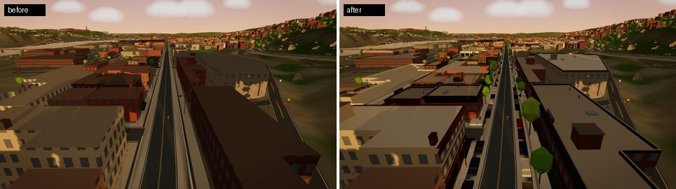
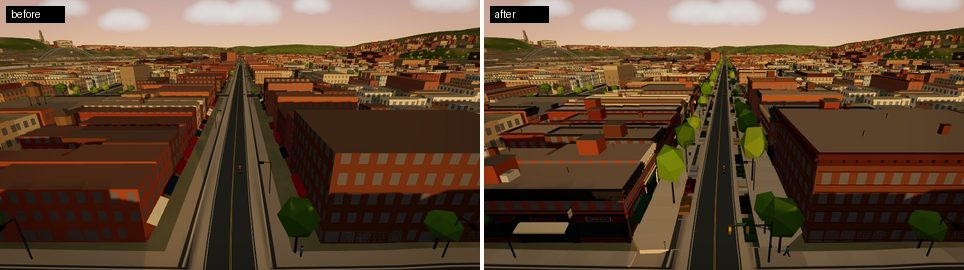
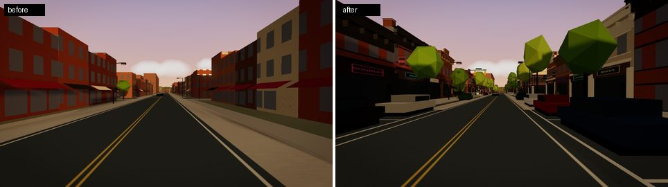
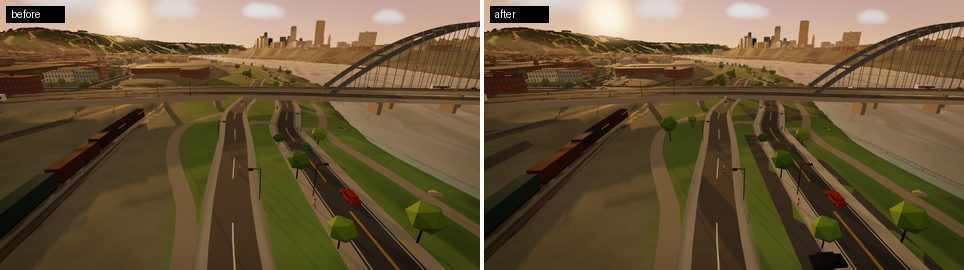
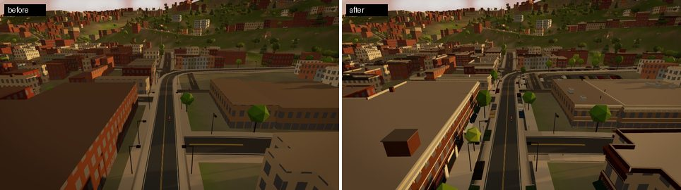
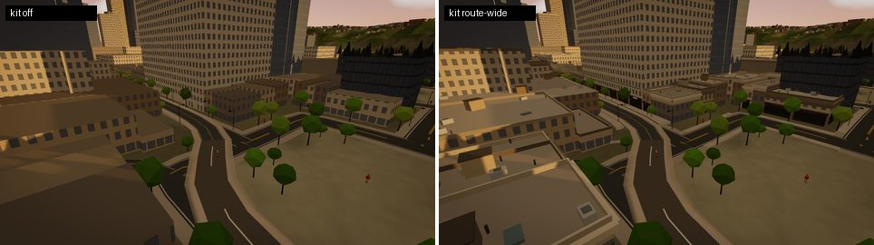

# S3 · South Side and the street & facade detail kit

Section: Station Square → East Carson 10th → 18th → 27th → SouthSide Works riverfront → South Side Riverfront
Park → South Side Trail → Muriel & S 10th → East Carson 10th → McArdle Roadway foot (5.25–10.95 km).
Shared system: **the street & facade detail kit** (`js/world/street-kit.js`, `js/world/street-grade.js`,
`tools/citylib/street_kit.py`).

## What changed

### East Carson no longer rides on a wall

**Cause.** The city landscape grades the ground beside *every* route road to the road's height − 0.5 m out to
13 m, easing back to the terrain by 60 m (`city-landscape.js`, `routeHeightAt`; and `heightAt` clamps it
under `r.y − .5` within 9 m). That margin keeps the 6 m ground mesh from poking through the road, but it
means the 7 m road and its 11 m shoulder ribbon stand 0.6 m above everything around them: on East Carson the
buildings, lamps and people stood in a trench and the road showed a grey side wall (baseline, 5.6 km).

**Fix (kit zones only).** `street-grade.js` gives a kit zone a real cross-section, hooked into `heightAt`
(`[street-kit]`):

| from the route's centre | surface |
| --- | --- |
| 0 – 3.5 m | the route's road (route line + `ROAD_LIFT`) |
| 3.5 m – `curbM` | the kit's asphalt / parking lane, at road level |
| `curbM` | the curb face, `CURB_H` = 0.15 m |
| `curbM` + 0.6 – 2.5 m | the ground ramps up (hidden under the slabs; the ground mesh can't step) |
| `curbM` + 2.5 – 14 m | ground = sidewalk top − 6 cm: buildings, lamps, trees and people stand on the sidewalk level |
| 14 – 32 m | eases back to the terrain |

Cross streets and alleys keep their own grading (the grade fades out within 5–12 m of any other carriageway), so
nothing is buried; their ends inside a junction belong to the junctions module. Decks and trails are untouched.
The kit's sidewalks run from the curb to the building line (at least 1.4 m), with a skirt down to the ground
where there is no building. The route's lamps in a zone stand at the curb on the sidewalk, and the
old main-street awnings (`city-bridges.js`) give way to the kit's storefronts. East Carson's curb is at 6.4 m (a 2.9 m parking lane), so the sidewalks are 4–6 m
deep, matching the mapped building line (11–13 m from the centre).

**What road alignment (S4) should generalise:** a street's cross-section should come from the street, not from
a fixed bank under the route:
- ground under a carriageway: the carriageway's level minus a small margin, only *between the curbs*;
- ground beyond the curbs: the sidewalk level (carriageway + 0.15 m) out to the building line, then easing to
  the terrain — not the road − 0.5 m bank the landscape uses today;
- curb lines from the map (OSM `width` / `lanes` / `parking:lane` or the building line minus a sidewalk), so a
  street is as wide as it is; the route's `ROAD_WIDTH` ribbon is just its two travel lanes;
- the 6 m ground mesh needs ≥ 2.5 m between the curb and where the ground reaches sidewalk level (or a finer mesh
  along streets) so it can't rise through the parking lane.
`makeStreetGrade` is route-agnostic: any scene with kit zones gets it, and the QC sweep sees the same ground.

### The section, dressed
- **East Carson (5.25–7.86 km)**, `victorian` zone: storefront ground floors (glass lit at night, fascia with
  shop signs named by what OSM maps there — no brands —, pilasters, transoms, doors, awnings, blade signs),
  cornices with brackets and friezes, belt courses, two-storey canted bays, sills and lintels, parapets with
  pediments, rooftop stair heads, HVAC, vents, chimneys, skylights and the odd 3 m timber water tank; 4–6 m
  sidewalks, parking lanes with stall ticks and parked cars, street trees in tree pits every 15 m, meters,
  benches, bins, bike racks, planters, hydrants, corner street signs, bus stops and signal masts from OSM.
- **S 10th & E Carson (10.33–10.86 km)**, `rowhouse` zone: the same street furniture and trees, rowhouse fronts.
- **SouthSide Works riverfront, Riverfront Park and the South Side Trail (7.9–10.3 km)**: loose groups of park
  trees on the grass either side (more on the landward side), benches and bins every 70 m, picnic tables on the landward grass every 140 m, trail marker posts every 400 m, river-wall railings, the
  OSM-mapped benches / picnic tables / bike racks / drinking fountains, car parks with painted stalls and parked
  cars, fences and walls from OSM.
- Elsewhere in the kit's span every building with a kind that has a style (`AUTO_STYLE`) gets its trim, and
  every class 2–6 ground street gets curbed sidewalks.

## Pictures

Golden hour, Balanced, software GL, every city chunk and every kit chunk built (a copy of `snap_scene.mjs` that
flushes the city's queue); "before" = this branch with the scene's `streetKit` removed, which also turns the
cross-section grading off. The coordinator's baseline shots are in `/home/claude/baseline/`.

Each picture: before (left) and after (right).

| | |
| --- | --- |
| East Carson west of 10th, 5.6 km — the road no longer sits on a bank; sidewalks to the walls, trees, parked cars |  |
| East Carson at 18th, 6.6 km — storefronts, cornices, bays, rooftop clutter at roof scale, tree pits |  |
| East Carson at eye level, 6.9 km — shop signs, parking lane with cars, meters, street trees |  |
| The South Side Trail by the Hot Metal Bridge, 8.8 km — park trees, benches, curbed sidewalks on the side road |  |
| S 10th / E Carson, 10.7 km — the `rowhouse` zone |  |
| Route-wide test, Market St downtown, 3.45 km — kit off / kit on with `"fromM": 0` (no zone: styles by kind) |  |


## Numbers

Every chunk built (steady state), Balanced, 960×540, software GL. Draw calls include the shadow pass.

| shot | draw calls before → after | triangles before → after |
| --- | --- | --- |
| 5600 | 438 → 446 (+8) | 1.33 M → 1.55 M |
| 6600 | 310 → 317 (+7) | 1.01 M → 1.29 M |
| 6900 eye | 274 → 277 (+3) | 0.95 M → 1.17 M |
| 8800 | 709 → 692 (−17) | 1.65 M → 1.82 M |
| 10700 | 254 → 258 (+4) | 1.10 M → 1.26 M |

The kit's own meshes add 10–18 calls in view; the city's smaller rooftop water tanks (now only on 4+ storey roofs)
take some chunks' rooftop-extras meshes (and their shadow pass) away, which is why 8.8 km, looking at downtown,
comes out lower.

- The kit builds 88 meshes for the whole section (≤ 4 per chunk, ~3 in view near the rider after LOD),
  632 k triangles in all; 1,239 styled buildings, ~3,050 pieces of furniture, 543 parked cars, 99 car parks,
  street and park trees on the city's instanced tree meshes (no extra draw calls).
- **Route-wide** (`fromM` 0, measured downtown): 3450 m 436 → 482 calls (+46), 1.27 → 1.58 M triangles;
  650 m 539 → 593 (+54), 1.42 → 1.73 M. 2,854 styled buildings, 271 kit meshes, 1.5 M kit triangles in all,
  6.5–9.6 s of kit work at load on this VM. It works (picture below) but it's close to the budget at 650 m.
- **8800 is over the 600-call budget before the kit** (709 with every chunk built; the coordinator's baseline
  snap, with fewer chunks built, shows 486). Most of it is the shadow pass (×2 per caster) — S1's baked
  lighting is what brings it under. The kit's own share there is 12 calls.
- Build time (2-CPU VM shared with three other agents, software GL, so slow and noisy): 1.7–2.8 s of kit work
  for the whole section at load; while riding it runs in 1.5 ms slices (time-checked yields), ~1,000–1,200
  slices. The longest single slices are 25–45 ms here (one car park's triangulation, one big builder's
  `geometry()`, one large building's trim); expect ~5–10 ms on the M4 — see "What's left".
- QC: `npm test` 96 pass; `npm run qc -- pittsburgh --strict` 0 fail 0 warn (baseline 0 / 0).
- `npm run qc:clipping -- --no-life`: **0 fail, 99 warn** (baseline 0 / 91), info 118 (baseline 55).

  | warn | baseline in S3 → now | baseline elsewhere → now |
  | --- | --- | --- |
  | ground-over-street | 6 → 32 | 52 → 34 |
  | post-in-solid | 6 → 0 (the old awnings) | 12 → 12 |
  | scenery-on-street | 0 → 6 | 0 → 0 |
  | floating | 2 → 1 | 1 → 2 |
  | z-fight / structure-through-building | 1 / 0 → 1 / 0 | 10 / 1 → 10 / 1 |

  Elsewhere the drop is the QC fix (ground hidden under a slab or the road no longer counts). In S3 the new
  ground-over-street warnings are at junction corners: the raised sidewalk-level ground meets cross streets that
  still sit at the old road − 0.5 m level, and the 6 m ground mesh bulges over the old OSM sidewalk ribbons
  (14) and street ends (9) there, and over a few kit sidewalks along those streets (8, 4–31 cm). That seam is
  the junctions module's (corner pads at `sidewalkTop`, street ends at road level). The 6 scenery-on-street
  are terrain shrubs on a kit sidewalk along a side street at 9.0 km. Info `sunk`: 61 route lamps and 13
  street trees in S3 stand a little into the kit's slabs (their feet are at the ground under the slab, by design).


## The kit

### Catalogue

**Facade styles** (`FACADE_STYLES`, selectable per zone, else by building kind via `AUTO_STYLE`):

| style | for | store fronts | cornice | bays | parapet | other |
| --- | --- | --- | --- | --- | --- | --- |
| `victorian` | 2–4 storey brick main streets (East Carson) | 92 %, 4.1 m, 5–8 m units | 0.75 m, brackets, frieze | 35 % | 75 %, pediments | belt course, sills, awnings 40 %, blade signs |
| `rowhouse` | brick rows | 12 % (corner shops) | 0.45 m, brackets | 20 % | 50 % | sills |
| `masonry` | downtown stone / brick blocks | 60 %, 4.6 m | 0.9 m heavy | — | 90 % | belt course |
| `industrial` | warehouses, works | — | plain coping | — | 100 % | loading doors |
| `tower` | a tower's base | 80 %, 5 m | 0.8 m + a base cornice at 9 m | — | 100 % | |
| `glass` | glass towers | 90 % dark glazed base | — | — | 100 % | canopies |

**Rooftops** (every styled building): stair / elevator heads on 3+ storeys (2.8 × 3.4 m), HVAC units
(1.3 × 1.9 m), vent stacks, chimneys on houses, skylights, and timber water tanks at 2.8 m across on 4+ storey
commercial roofs (22 %).

**Furniture** (`FURNITURE`, each a function drawing at a frame; front = local +z):
`signal` (mast, arm, two heads, walk signal, street blade), `pushButton`, `streetSign`, `stopSign`, `busSign`,
`shelter`, `hydrant`, `meter`, `bench`, `waste`, `bikeRack`, `planter`, `bollard`, `postBox`, `drinking`,
`picnic`, `trailMarker`, `treePit`, `car`.

**Surfaces**: curbs and sidewalk slabs (with joints and a skirt), the route's asphalt out to the curb with parking
stalls, car parks (OSM `amenity=parking` surface lots: draped asphalt, stall rows, parked cars), fences / walls /
hedges / retaining walls / guard rails / jersey barriers (OSM `barrier=*`), railings on river walls.

**Street trees**: tree pits along kit zones (`trees`: spacing), sized so crowns stay out of the rider's space and
clear of the walls, 1.35× taller than the city's other trees so the crowns clear the shop signs; and loose groups
on the grass beside the route's trails (`parkTrees`). Both are drawn by the city's instanced street trees (no
extra draw call).

### Cost and LOD
Merged per city chunk (320 m) into at most four meshes: `Sidewalks · kit` (ground surfaces, always drawn),
`Street kit · facades` (mid: cornices, parapets, rooftop clutter, fences, glass; Balanced 750 m),
`Street kit · furniture` (near: furniture, cars, storefront detail, shop signs — one material with the sign
atlas; Balanced 260 m) and, only if the city doesn't hand the kit its building builder, `Street kit · bays`.
Bay walls go straight into the city's building mesh. LOD distances per preset: Light 160 / 450 m, Balanced
260 / 750 m, High 380 / 1100 m. The kit's mid and near meshes don't cast shadows (bays do, as walls).
Chunk work is a generator: while riding it runs ≤ 3 ms a frame (`budgetMs`), nearest chunk first; at load
everything is built at once. Nothing enters the rider's tube (`_keepOutOfTube` drops whole pieces).

### Scene keys
```jsonc
"streetKit": {
  "fromM": 5250, "toM": 10950,      // the stretch of route the kit dresses (outbound metres)
  "rangeM": 220,                     // how far from the route
  "parkTrees": 16,                   // trees on the grass beside the route's trails, spacing in metres (default 0)
  "zones": [
    { "name": "East Carson Street", "style": "victorian", "fromM": 5250, "toM": 7860,
      "widthM": 90,                  // buildings within this of the route take the zone's style
      "parking": true,               // parking lane + parked cars along the route
      "curbM": 6.4,                  // the route's curb line from its centre (default 5.9)
      "sidewalkM": 4,                // sidewalk depth where no building line is closer (default 3)
      "trees": 15,                   // street-tree spacing, metres (default 0: none)
      "grade": true }                // sidewalk-level ground (default true)
  ]
}
```
Without `zones` the scene's `mainStreets` become `victorian` zones. Without `streetKit` the kit is off and
nothing changes. OSM details come from the city data's `streetKit` block, written by `tools/build_city.py`
(`tools/citylib/street_kit.py`: signals, bus stops, benches, hydrants, bike racks, bins, picnic tables, post
boxes, fountains, bollards, shelters, stop signs; shop categories; surface car parks; fences and walls); without
it the kit's own spacing rules still dress everything.

**Another route** (any `authored-city` scene): rebuild its city data (`python3 tools/build_city.py <id>`) and add
a `streetKit` block with zones for its main streets. Pick the facade style per zone; buildings outside zones are
styled by kind. Safe route-wide: `"fromM": 0` and no `toM`; zones only where the route is a city street.

### JS API (`city.streetKit`, a `StreetKit`)
- `addCorner({ x, z, yaw, arm = 5, signal = true, sign = true, button = signal, bollards = 0, y })` — **the
  junctions module's entry point**: one corner's signal mast (arm reaching towards `(sin yaw, cos yaw)` over the
  approach lanes), push-button post, street-name sign and bollards, at the corner's pole spot.
- `externalJunctions(true)` — the junctions module takes signals and corner signs over: the kit stops placing
  its own masts (from OSM signals) and corner street signs.
- `addSignal(x, z, yaw, arm, opts)`, `addFurniture(kind, x, z, yaw, opts)` — any catalogue piece; `opts.y`
  (default: `sidewalkTop`), `opts.lod: 'mid'`. Call from a module built in CityScene's constructor (before chunks
  stream); later calls work too, at one extra mesh for the chunk.
- `sidewalkTop(x, z)`, `curbAt(s)`, `CURB_H`, `ROUTE_CURB` — levels and curb lines the junction pads must meet.
- `FACADE_STYLES`, `AUTO_STYLE`, `FURNITURE` — exported catalogues (add a style or a piece there).
- Hooks the city calls: `building(b, ring, ground, y0, y1, wall, key, B)`, `finishChunk(key, out)`,
  `routeLamp(s, side)`, `treeSpots()`, `tick(camera)`, `setQuality(key)`, `flush()` (tools).

### Hot-file edits (all tagged `[street-kit]`)
- `js/world/city.js`: import; build the kit after `_water()` (before the lamps and trees); pending chunks include
  kit-only chunks; `building()` call in `_buildChunk` (+ the builder `B`), roof colour, `_rooftop(…, kit)` skip;
  `finishChunk`; route lamps in a zone from `routeLamp()` (at the curb, on the sidewalk; none in junction gaps); kit street trees in `_trees` (spots, no re-check, a taller scale `sy`); `deferred` flag in `_stream`; `tick`, `setNight`, `setQuality`.
- `js/world/city.js` `_rooftop`: the city's own rooftop water tanks (outside the kit) at a believable size —
  3 m across, 2.6 m tall on 1.8 m legs, only on buildings over 13 m (were 4.4 m across on 3.5 m legs).
- `js/world/city-landscape.js`: import and one `grade(...)` call in `heightAt`.
- `js/world/city-bridges.js`: the old main-street awnings are off when the scene has `streetKit`.
- `tools/build_city.py`: import and `out['streetKit'] = street_kit.extract(...)`.
- `tools/qc-clipping.js`, `tools/snap_scene.mjs`: `streetKit.flush()` after the city's chunks are built, so the
  checks and pictures see the kit's deferred chunks.
- `tools/qc-clipping.js` ground-over-street: not counted where the ground is itself under a surface (a slab, the
  road) within 1.5 m — the kit's sidewalks sit over the old, now-hidden OSM sidewalk ribbons and the route's own
  street ribbon, which the raised ground covers out of sight.

## For the other agents
- **Junctions (S2):** the kit's sidewalks stop at another street's carriageway with a curb cap; corner pads should
  meet them at `sidewalkTop()` (= road + `ROAD_LIFT` + `CURB_H` along a kit zone) and the curb line `curbAt(s)`.
  Call `externalJunctions(true)` and `addCorner()` per corner. Cross streets near East Carson still sit at the old
  road − 0.5 m level: the junction surface should bring their ends to the route's road level.
- **Road alignment (S4):** see the cross-section notes above; the grade lives in `street-grade.js` and is easy to
  fold into a general street cross-section.
- **Baked lighting (S1):** kit meshes are static (`matrixAutoUpdate = false`), receive shadows, don't cast; bay
  walls are in the building meshes. Shop-window / sign glow uses the city's `night` uniform.

## What's left
- **Junction corners** (S2): kit sidewalks stop at cross streets with a curb cap; those cross streets still sit
  at the old road − 0.5 m level, so the cap is ~0.8 m high until junction surfaces bring the street ends up to the
  road. The route's 11 m shoulder ribbon shows as pale patches in the junction gaps.
- **Longest work slices**: a car park's triangulation and a builder's `geometry()` can't be split further; on the
  M4 they should be ~5–10 ms. If that shows as hitches, pre-split big car parks and cap a chunk's near mesh.
- **Draw calls at 8.8 km** (709 before the kit, every chunk built): needs S1's baked shadows.
- Shop labels can repeat on neighbouring units; storefronts follow OSM footprints, so a deep irregular footprint
  gets odd unit widths. A real per-building sign list (from OSM `shop=*` names, without brands) would help.
- Parked cars are four merged boxes each (~50 triangles, 543 in the section): cheap, but blocky up close; a
  shared low-poly car (instanced, with the traffic's model) would look better.
- Some OSM car parks overlap streets near SouthSide Works: the triangles over a carriageway are dropped, which
  leaves those lots patchy.
- Route-wide switch-on (`"fromM": 0`) works (measured downtown: +46–54 calls, +0.3 M triangles, 6–10 s of kit
  work at load on the VM); at 650 m that lands at 593 calls, so switch it on after S1's baked shadows, and
  consider a smaller `rangeM` downtown.
- Zones are hand-placed by route metres; they could come from OSM (building density / `shop=*` frontage).

