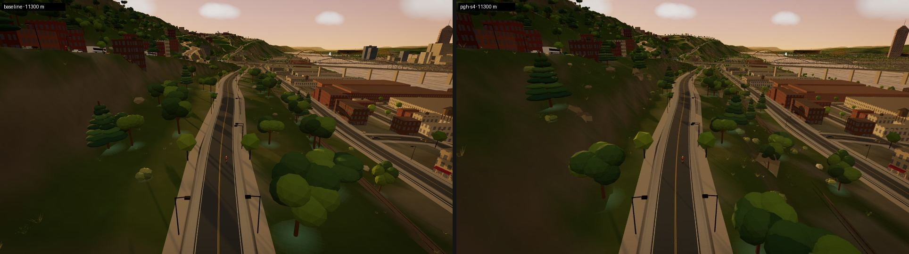
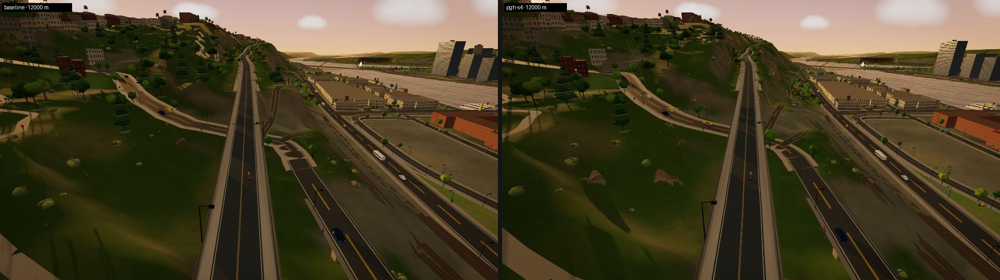
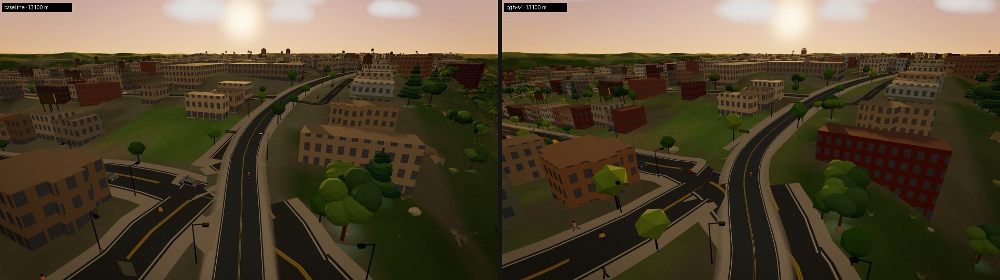
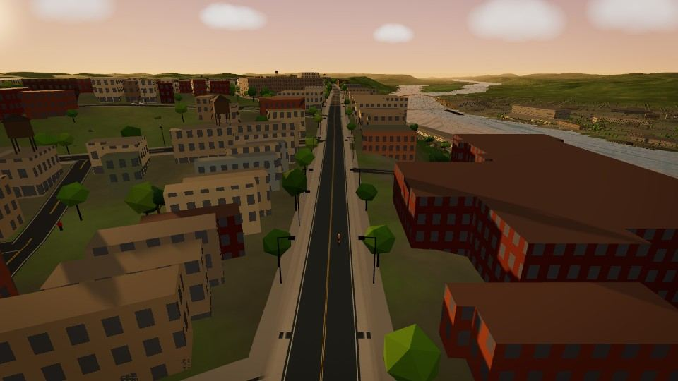
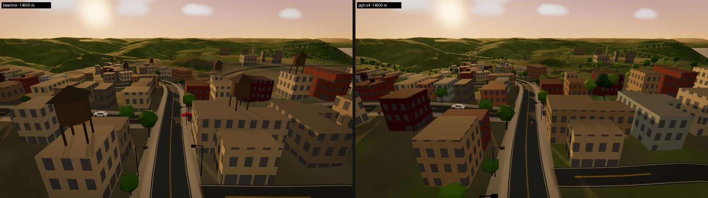
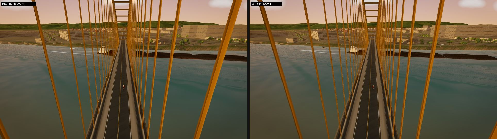
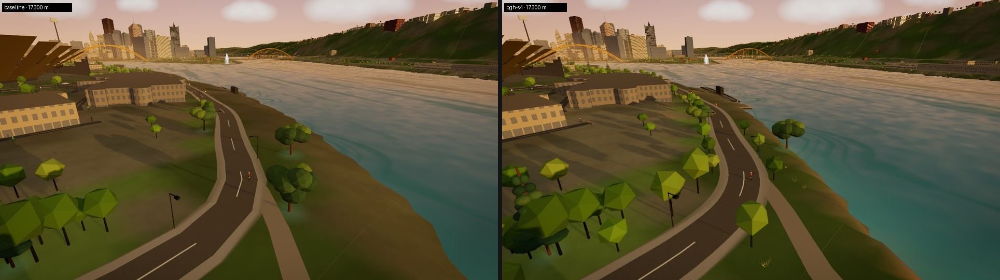

# S4 · McArdle → Grandview → West End Bridge → North Shore finish, and road alignment

Section agent S4, branch `pgh-s4` (16 Nov 2026). Section: McArdle Roadway foot (10.87 km) → McArdle viaduct →
McArdle top (12.33) → Grandview Avenue overlooks (13.10) → Duquesne Incline top (13.64) → Grandview W (14.13) →
West End Bridge (15.75–16.41) → Carnegie Science Center (17.43) → USS Requin (17.73) → Water Steps finish
(18.31). Shared system: **road alignment** — smooth centrelines and grades for the route and the city streets,
plus course-QC checks for them.

## What changed

| | before | after |
| --- | --- | --- |
| Route on the Mount Washington crest (13.3–14.2 km) | 4–6 m above its own ground (a 160 m dip fill) | on its ground: worst +3.1 m, and that is the app's ±60 m elevation smoothing |
| Kinks in the route ribbon (10 m pieces, 25–50° each at city corners) | drawn-line turn-rate jumps: p99 12.6 °/m², worst 48.8 | p99 0.7, worst 2.1 (curved centre line) |
| Street profiles near the section (grade change between 7 m pieces) | p99 21.9 %-points, 133 jumps > 25 | p99 6.2, 3 jumps > 25 |
| Street grades > 35 % near the section | 117 | 0 |
| Ramp and viaduct decks (McArdle, West End) | inverse-distance heights: flat at both ends, twice as steep in the middle | straight between their ground ends |
| Hillside neighbourhoods (Mount Washington, Duquesne Heights, West End) | unmapped land drawn as grey paving; small footprints as 4-storey shop blocks with water tanks | yards with trees; small untagged footprints as houses and rowhouses (no tanks) |
| McArdle Roadway past the viaduct (12.09–12.33 km) | its mapped way (11 m, up to 5 m off the route's line) drawn 0.3–1 m under the road: its outer half showed beside the road and z-fought the route's cut | pinned just under the road along its length; the ground under it follows it |
| Streets pinned under the route | the nearest 10 m sample's height: 0.4–0.8 m stairs on climbs | the road's height between samples |
| North Shore riverfront (16.5–18.2 km) | a bare lawn beside the trail | tree rows on both sides of the trail |

Pictures (golden hour, Balanced, software GPU, 960×540; left the baseline, right this branch). The route's key
positions moved by up to 10 m, so the chase camera frames each spot slightly differently:

| | |
| --- | --- |
| 11.3 km McArdle Roadway |  |
| 12.0 km McArdle viaduct and ramps |  |
| 13.1 km Grandview Avenue |  |
| 13.45 km the crest (was +6 m; this branch only) |  |
| 14.6 km Grandview W hillside |  |
| 16.0 km West End Bridge |  |
| 17.3 km North Shore to the finish |  |

Budget (same shots; draw calls / triangles):

| | baseline | this branch |
| --- | --- | --- |
| 11.3 km | 451 / 1.63 M | 443 / 1.71 M |
| 12.0 km | 437 / 1.50 M | 435 / 1.61 M |
| 13.1 km | 299 / 1.18 M | 329 / 1.32 M |
| 13.45 km | — | 338 / 1.49 M |
| 14.6 km | 213 / 1.15 M | 249 / 1.24 M |
| 16.0 km | 230 / 0.89 M | 233 / 0.93 M |
| 17.3 km | 504 / 1.42 M | 509 / 1.48 M |

The extra triangles are trees (the kit's broadleaf models in yards; the city's 40-triangle street trees on the
yard grid and along the North Shore trail).

## Road alignment: the design

Two halves. The builder decides where the route and the streets *are*; the run time decides how they are
*drawn* and how high the streets sit (heights depend on the run-time ground: the terrain grid, the river banks
and the route's own bank).

### Builder — `tools/citylib/road_align.py` (numpy/scipy, route-agnostic)

- **`Clearance(polygons, clear_m)`** — "is this point at least 3.2 m from every building?", rasterised lazily in
  64 m tiles at 0.5 m with a distance transform.
- **`align_plan(raw, clear, drift, loop, corner_passes, corner_half_window, max_turn, fair_iters)`** — the mapped
  line resampled every 2 m is rounded (box filter), eased where it still turns faster than 4.5 °/m, then *faired*
  (240 bi-Laplacian steps: removes 10–30 m wiggles, keeps a corner's shape). After every step each point is
  projected back into the corridor: ≤ `drift` m from the mapped line and clear of buildings. The projection is
  continuous — a point that would enter a building slides back towards the mapped line only as far as it must.
  The old leash snapped such points straight back to the raw corner, which is what left the 1–2.6 m sideways
  jumps and kinks (8.06, 3.75, 14.54, 13.06 km…).
- **`align_profile(ele, step, loop, spike_m=20, notch_m=20, max_grade=.2, max_grade_change=.03, mean_m=30)`** —
  shaves spikes < 40 m wide, fills only notches < 40 m wide (where the line brushes a wall or a cliff edge), then
  limits grade and grade change and averages lightly. The old profile filled every dip narrower than 160 m: on
  the Mount Washington crest the road rode 4–6 m over the real dips of Grandview Avenue.
- **`deck_heights(edges, anchors)`** — bridge and ramp decks solve the graph Laplace equation (weights 1/length)
  with their ground ends fixed: a two-ended deck is a straight ramp; a forked one blends smoothly.
- **`round_street(pts, fixed, max_shift=1.5)`** — street polylines drop OSM jitter (< 0.25 m off the line) and
  round free corners with a short arc whose middle stays within 1.5 m of the mapped corner. Junction nodes
  (shared by two or more ways, or by the route) and the ends never move, so the street graph stays connected.

Hooks in `tools/build_city.py` (tag `[road-align]`): the plan smoothing, the profile, the deck heights and the
street packing. Config keys in `tools/city/<id>.json`: `maxDriftM`, `cornerPasses`, `cornerHalfWindow`,
`clearM` (3.2), `fairIters` (240), `profile` ({spike_m, notch_m, max_grade, …}), `roundStreets` (true),
`streetShiftM` (1.5).

### Run time — `js/world/road-align.js` (pure functions; the QC sweep uses the same code)

- **Curved centre line** (`roadAlign.curve`): the app keeps every route as samples exactly 10 m apart. Drawn as
  straight pieces a tight city corner shows as a row of kinks. With the key on, `routePoint()` (pose.js: rider,
  chase camera, QC) and the road and shoulder ribbons (`denseRoad()`, 4 points per sample) follow a uniform
  Catmull-Rom curve through the same samples. It passes through every sample, so everything placed at a sample
  still lines up; between samples it differs from the straight piece by at most ~L·θ/8 (0.5 m at a 25° corner).
  Heights stay straight between samples. `curveXZ(index, i, f)`, `denseRoad(route, index, per)`, `curveOn(route)`.
- **Street profiles** (`roadAlign.streets`): `alignStreetProfiles(streets, options)` runs at the end of
  `cityStreets()`:
  1. reference heights: the ground as before (raised towards the route near it); streets mapped below another
     level (layer < 0) that never meet the route follow their own bare ground away from the route; no ground
     street below the water's surface + 0.6 m;
  2. each ground street is smoothed along its length (Gaussian, σ 9 m);
  3. **one height per junction node** (points shared exactly by two or more streets): a deck's height wins, then
     the route's (points kept just under the route's road are *pinned*), else the width-weighted mean of its
     streets; soft junctions joined by a street are relaxed so no street between them is steeper than
     `maxGrade`;
  4. each street gets the corrections at its fixed points spread linearly between them (fading over 30 m past
     the last one), then grade (30 %), grade-change (2 %-points per metre) and ground-deviation (3 m) limits —
     the grade limit has the last word.
  After the solve the street points over the route are kept just under its road again and every junction node
  touched by such a pin takes the same height (`syncPinnedNodes`).
- **The street the route rides on** (`lower(p, width, along)` in `cityStreets`): a street point whose street runs
  along the route (within ~20°) with the route's centre line inside its carriageway is pinned just under the road
  even when the ground left it up to 2.5 m lower (before, only points already within 0.18 m of the road were). Pins
  take the road's height interpolated between its samples (`routeDist`). A street wider than the route's road that
  rides it (`st.rides`) also sets the ground under its carriageway, so its outer half lies on the ground instead
  of being half-buried by the route's bank.
- **`roadAlign.bankM`** — how far the ground eases towards the route's road (was a fixed 60 m). A route that now
  follows its own ground needs less: Pittsburgh uses 30 m, so streets beside the route stop riding up its bank.

Scene keys (Pittsburgh): `"roadAlign": { "curve": true, "streets": true, "bankM": 30 }`. Optional solver
limits in the same object: `smoothM`, `maxGrade`, `maxGradeChange`, `maxDeviation`, `fadeM`
(`STREET_DEFAULTS`).

**Another route switches it on** by adding `"roadAlign": { "curve": true }` to its scene (any route: the curve is
independent of the city), and `"streets": true` on a city scene. City routes rebuilt with `build_city.py` get the
builder half automatically. Cost: the street solver takes ~0.3 s in Node for Pittsburgh's 3,600 streets (once,
while the scene is built); the curve adds 3 vertices per 10 m to two ribbons.

### Section scenery keys (`[s4-section]`, any city scene)

- `vegetation.yardTrees = { density, spacingM = 15, kitDensity = .5, boxes: [[s, w, n, e]…] }` — inside the
  boxes (lat/lon), yards (land use 8) get the city's light instanced trees on a jittered `spacingM` grid
  (`density` of the cells, crowns 3 m clear of houses, within 650 m of the ride), and `kitDensity` of yard spots
  accept the shared kit's trees (which grow in its grove patches; the city keeps them 3.5 m clear of houses).
- `routeTrees = [{ fromM, toM, spacingM = 12, offsetM = 7.5, sides: [-1, 1] }]` — tree rows along the route
  (−1 left, 1 right of the ride), each spot dropped unless clear of carriageways, buildings, water and the road.
- `residentialBoxes` (builder, `tools/city/<id>.json`): unmapped land in the boxes is yards, not paving. Keep the
  boxes off flats with rail yards and commercial land (Pittsburgh's stop at Station Square).

### Hand-off to S2 (junctions)

S4 owns street centrelines and heights **between** junctions; S2 owns everything **inside** a junction radius.
What S2 can rely on:

- junction nodes are the OSM node positions shared by two or more street records; the builder never moves them
  (`round_street` keeps them), so they are bit-identical across the streets in the city data;
- after `cityStreets()`, every ground street passing through a junction node has exactly the node's height;
  `streets.junctions = [{x, z, y, deck, route, streets: [k…]}]` lists them (y: the junction's height; deck: a deck
  meets it; route: it is pinned under the route's road);
- approach grades are limited (30 %, ≤ 2 %-points per metre) up to the node, so a level junction plate at `y`
  of radius r needs at most a gentle blend; levelling inside r (the old `_levelJunctions`) is S2's;
- streets crossing at different levels (deck over street, street under the route) are not joined: a deck or
  the route only joins streets that reach it within 4 m.
- every deck, viaduct and ramp end in S4's section meets the ground or its parent street: the `street-step` check
  finds no junction node within 300 m of the route whose streets differ by > 0.3 m, and no deck end hangs over
  the ground except the West End Bridge's north footpath (16.41 km, +2.0 m, 12 m right of the route).
  The "mid-air" ends beside the McArdle viaduct in the old chase shot at 12.07 km are streets passing *under*
  the viaduct (service road and the ramp down to Carson Street, 12–15 m below the deck): from the high chase
  camera the deck hides them, so they look cut off. Real, not a height fault.

**Meeting sites whose heights are still wrong** (S2 or wave 2):

| km | what | off by |
| --- | --- | --- |
| 11.45 | two footpath ends on the bluff below McArdle (no junction): above the ground | 4.6 m, 1.3 m |
| 11.94 | footpath end 260 m left of the route | 3.6 m |
| 12.30 | footpath stub 50 m right of McArdle top | 2.9 m |
| 12.78 | tertiary street end (Grandview side), above the ground | 1.3 m |
| 13.30 | a motorway deck end 190 m off the route: no ground street joins it there | 3.2 m |
| 14.53 | footpath ends, Grandview W | 1.4 m |
| 16.41 | West End Bridge north footpath deck end | 2.0 m |
| 2.5, 4.0 | Mon Wharf ramp, Smithfield Street Bridge approach: ramps weaving in and out of the route's corridor (pinned points next to the route, deck heights between) | sawtooth |

## Course QC: new checks (`tools/qc_alignment.mjs`, hook in `qc_course.mjs`)

| check | what it catches | limit |
| --- | --- | --- |
| `lateral-jump` | one 10 m sample pushed sideways off the cubic through its neighbours, turning against both | 0.8 m, turns ≥ 4° |
| `heading-jitter` | the drawn centre line's turn rate jumps (2 m chords) — a kink you see | 3 °/m per m |
| `grade-crease` | the drawn road's grade changes sharply between 10 m pieces | 4.5 %-points |
| `route-off-ground` | (city) the road above/below its own bare ground, off bridges ±40 m | 4 m |
| `street-steep` | (city) a ground street steeper than any real one over ≥ 10 m | 38 % |
| `street-crease` | (city) a street's grade changes abruptly between ≥ 3 m pieces (step, hump) | 22 %-points |
| `street-step` | (city) streets meet a junction node at different heights | 0.3 m |
| `street-bank` | (city) a street on an embankment / in a trench: its drawn ground lower/higher on both sides, 6 m out | 5 m |

Street checks look at streets within 300 m of the route and skip points pinned under the route's road (the
route crossing is the junction work's). **Severity:** warn on scenes with `roadAlign` (street checks: with
`roadAlign.streets`), info elsewhere — so the report shows other routes' findings without failing routes that
don't use the system yet. `heading-jitter` is info on scenes without the curve (straight 10 m pieces are expected
there: Teton shows 94 such spots, Zion 45). One tune of an old check: the ledge/mesh checks
(`verge-step`, `mesh-coarse`) now start 20 m (was 12 m) past a bridge's end — at the McArdle viaduct's end
(12.11 km) the ground drops 15 m to the service road that passes under it, a cliff, not a carve.

One tune of the route-wide `street-over-road` check (city): it compares a street with the road *as drawn*
(straight between the 10 m samples), not with the nearest sample's height.

Whole catalog, `npm run qc -- --strict` (16 Nov, 12:00): **every route 0 fail, 0 warn** (exit 0); the report
lists 854 `heading-jitter` info spots on routes without the curve. The baseline Pittsburgh measured with
the new checks (scene opted in): 69 warnings — 39 street creases, 15 steep streets, 12 street banks, 2
route-off-ground (the crest), 1 lateral jump — plus 700+ heading-jitter spots on its straight pieces.

**Is the curve safe for every route?** With `curveOn` forced true for the whole catalog, `--strict` still passes
every route (all old checks, all new ones) and the heading-jitter spots drop to 0 (Route 28: 1). Switching it on
is one scene key per route; left to the coordinator / the user.

## Numbers

Measured on the route as the app builds it (`buildCatalogRoute`) and the streets as the renderer draws them
(`cityStreets`), section 10.8–18.4 km / whole route:

| | baseline | this branch |
| --- | --- | --- |
| drawn-line jitter, p99 / max (°/m per m) | 11.9 / 37.1 · 12.6 / 48.8 | 0.6 / 1.7 · 0.7 / 2.1 |
| rider heading-rate change, p99 (°/m per m, chase cam) | 1.02 · 1.04 | 0.16 · 0.19 |
| 10 m samples > 0.6 m off the cubic through their neighbours | 9 · 30 | 6 · 24 (all at tight real corners) |
| route − bare ground (off bridges): samples > 2 m above / below | 34 / 31 · 48 / 32 | 16 / 23 · 24 / 24 |
| worst route over ground | +6.2 m (13.44 km) | +3.1 m (15.62 km) |
| route grade change per 10 m, max | 1.43 % | 1.54 % (real dips kept) |
| climb | 187 m | 219 m (the real dips of Grandview Avenue) |
| street grade > 20 % / > 35 % (points) | 504 / 117 · 793 / 269 | 265 / 0 · 355 / 3 |
| street grade change p99 (%-points) / > 25 | 21.9 / 133 · 27.4 / 396 | 6.9 / 3 · 6.4 / 7 |
| street vertices turning > 25° / > 45° at one vertex | 397 / 125 · 739 / 332 | 147 / 21 · 309 / 54 |

Key positions moved by ≤ 10 m (Duquesne Incline top 13.63 → 13.64, West End Bridge N 16.40 → 16.41, USS Requin
17.72 → 17.73, McArdle bridge end 12.09 → 12.10 km); the scene's distance-based placements need no change.

Clipping QC (`npm run qc:clipping -- --no-life`, 16 Nov 13:15): **0 fail, 70 warn, 51 info** — baseline 0 fail, 91
warn, 55 info. Ground-over-street 58 → 40, post-in-solid 18 → 14, z-fight 11 → 11, floating 3 → 4 (lamp posts at
9.76, 9.96, 15.98 and 16.02 km; the last two on the West End Bridge deck), no tree-in-solid (an earlier box
put yard trees on the Station Square tracks; the boxes now stop short of the Mon flats).

## Edits to hot shared files

| file | tag | what |
| --- | --- | --- |
| `tools/build_city.py` | `[road-align]` | import; plan smoothing → `align_plan`; profile → `align_profile`; deck heights → `deck_heights`; street packing → `round_street` |
| `tools/build_city.py` | `[s4-section]` | `residentialBoxes` painted as yards before land use |
| `js/world/toolbox/city/landscape.js` | `[road-align]` | import; `lower()` (pins street points kept under the route, incl. the street the route rides on, at the interpolated road height) + `alongRoute`; `rides` in `heightAt`; `alignStreetProfiles` + `syncPinnedNodes` at the end of `cityStreets`; `bankM` in `routeHeightAt` |
| `js/world/toolbox/city/landscape.js` | `[s4-section]` | `canPlant`: yards inside `yardTrees` boxes |
| `js/world/toolbox/city/city.js` | `[s4-section]` | `canPlant` wrapper keeps yard trees off houses; `_trees()`: yard grid and `routeTrees` spots, `t.wall` |
| `js/world/world.js` | `[road-align]` | import; `denseRoad()` at the top of `makeRoad` and `makeRibbon` |
| `js/world/pose.js` | `[road-align]` | `routePoint()` follows the curve when on |
| `tools/qc_course.mjs` | `[road-align]` | import + `alignmentChecks()`; ledge/mesh checks skip 20 m past bridge ends; `street-over-road` vs the drawn road height |
| `routes/scenes/pittsburgh.json` | — | `"roadAlign"`, `vegetation.yardTrees`, `"routeTrees"` |
| `tools/city/pittsburgh.json` | — | `residentialBoxes` |

## What's left / hand-offs

- **S2:** the Mon Wharf ramp (2.5 km) and the Smithfield Street Bridge approach still have ramps that weave in
  and out of the route's corridor: their points next to the route are pinned under the road and the rest stay at
  deck height (sawtooth profiles; the street checks skip pinned points). Junction plates should take `y` from
  `streets.junctions`. The tan sidewalk flaps at the McArdle ramp junction (12.0 km) are junction geometry.
- **Terrain LOD:** a street on a steep side slope 70–100 m from the route (the ramp climbing north of McArdle, seen
  at 12.07 km) shows a jagged uphill edge: the far ground mesh is coarser than the street's level cross-section.
  Heights are right (the ground is graded to the street); the far mesh needs street-aware refinement or skirts.
- **West End Bridge approach (15.3–15.7 km)** and the North Shore past the Science Center are still plain: the
  bluff right of the approach is grass and boulders (really woods), and the Science Center lot is bare paving.
  A steep-slope woods rule in the builder would fix the first; lot fill (S3's kit) the second.
- **S3:** the hillside houses are still flat-roofed boxes (pitched roofs and porches would sell Mount Washington
  and the West End); roof water tanks are 4.4 m wide on 3.5 m legs — too big for rowhouses (now only on
  commercial/industrial roofs); a retaining wall / abutment piece for the McArdle viaduct's end (12.11 km) and
  the Grandview bluff; the hillsides between the streets are bare (P6 vegetation).
- **S1:** nothing needed; the road ribbons are now 4 points per 10 m (the bake should use the drawn geometry,
  not the 10 m samples).
- **Open:** streets the land grid puts in the water (riverside paths at 1.6, 4.45 km; Saw Mill Run in the West End
  at 15.3–15.8 km) were pressed 4.5 m under the river by the bank carve; they now sit at the water's level + 0.6 m,
  but the ground under them is still carved — a narrower water mask for creeks would fix it at the source. The
  route's ±60 m elevation smoothing in the app (`js/gpx.js`) still rounds the crest by up to 3 m; changing it
  would change every route's trainer feel.
