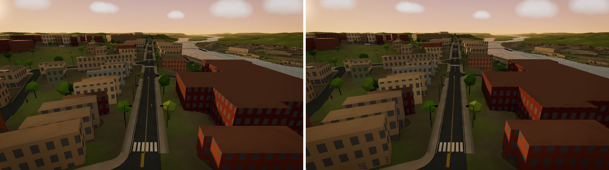
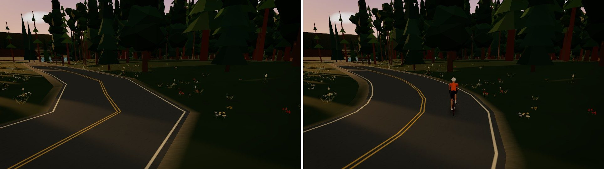
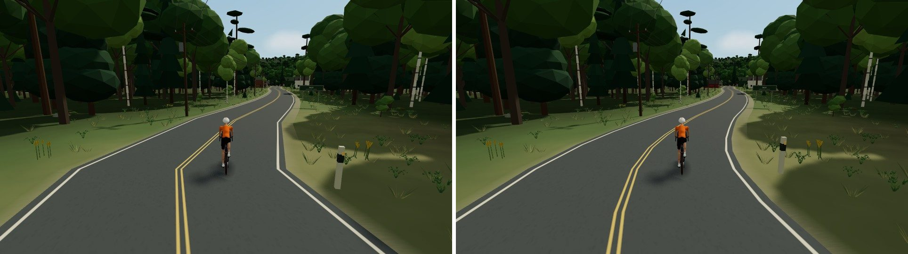

# Wave 2 · align (#6): road-alignment leftovers

Agent **align**, branch `w2-align` (16 Nov 2026), on top of `d6d65d5`. Three items from `OPEN.md` #6: the
Mount Washington crest riding above its ground, the jagged uphill edge of the steep street north of McArdle
(12.07 km view), and the curved centre line on routes other than Pittsburgh.

## What changed

| | before | after |
| --- | --- | --- |
| Crest 13.3–14.1 km: road − bare ground | +2.7 / −3.2 m, 37 samples off by > 1 m | +1.0 / −2.5 m, 2 samples > 1 m (one 30 m DEM bump, 13.99 km) |
| Whole route (off bridges): samples > 2 m off its ground | 45 (worst −3.4 m, 12.14 km) | 1 (−2.5 m, 13.99 km) |
| Trainer: grade change between 10 m samples, max | 1.55 %-points | 2.43 %-points (QC warns at 3, fails at 6) |
| Climb (catalog card) | 185 m (stale card; 204 m measured) | 224 m (the real dips and crests of Grandview Ave) |
| Pittsburgh streets within 250 m of the route: points where the ground mesh rises > 0.25 m over a street | 12,027 (292 patches) | 1,415 (100 patches; 613 in patches centred within 40 m of the route, where its bank rules; the rest at cliffs beyond the 4 m cap and between streets at different levels) |
| Curved centre line | Pittsburgh | Pittsburgh, **Going-to-the-Sun** (Route 28 trialled, left off: see below) |
| Curve's extra ribbon vertices (whole-route ribbons, drawn whole) | ×4 per 10 m everywhere | only where the curve bows: GTTS +52 % instead of +300 %, Pittsburgh +63 % |

## 1. Crest height

**Cause, measured.** The app's ±60 m moving average (`ELE_SMOOTH_M`) rounded the crest by up to 1.4 m — about
half of it. The rest came from the builder: the route's profile was the mapped OSM nodes' heights interpolated
along the way (nodes are 30–80 m apart on a straight street, so a dip or crest between them was filled or cut
by up to 2 m), then averaged over ±30 m.

**Fix (two halves).**

- **App, per route:** `buildRoute({…, eleSmoothM})` (`js/gpx.js`, default ±60 m, unchanged for every recorded
  GPX and every other route). A catalog entry may set `"eleSmoothM"`; `tools/build_routes.mjs` validates it
  (0–200) and copies it into `routes/parks/index.json`, which the app and every tool already pass to
  `buildCatalogRoute`. Pittsburgh: **±10 m** — its builder profile is already rideable (grade ≤ 20 %, grade change
  ≤ 3 %-points per 10 m, spikes shaved), so the app only needs to take the 0.1 m quantisation out.
- **Builder:** `road_align.line_elevation()` — the profile now samples the terrain along the **aligned line**
  every 10 m (the same z14 terrain the app's ground grid comes from), not the nodes. Bridge decks (±20 m) keep
  their straight interpolation and ease to the ground over 30 m; `profileKeep: [[fromM, toM]]` keeps the nodes on
  stretches the terrain can't see (Pittsburgh: the Mon Wharf ramp, 2.44–2.62 km — sampling the river wall there
  made the ramp step 3 m and the ground mesh couldn't follow); `profileFromLine: false | "roads"` turns it off or
  keeps the nodes on every trail. `align_profile`'s final average ±30 → ±20 m.

**Trainer feel.** Grades stay smooth: the largest change between 10 m samples is 2.43 %-points (was 1.55; course
QC warns at 3). Ridden at a steady 200 W with the app's physics (braking at 40 km/h), the grade the trainer gets
changes by at most 2.7 %-points per second (p99 1.48; was 1.58 / 1.06), and resistance at 20 km/h by at most
133 W/s (was 79). That's the real road: Grandview Avenue's dips are now ridden instead of averaged away.
`grade-crease`, `grade-step` and every other profile check pass.

Variants tried (all with the builder change): app ±20 m → crest 7 samples > 1 m, a `street-bank` warning at
2.82 km; ±30 m → a `junction-over-road` **fail** at 2.81 km (that junction's plate is within millimetres of the
road: the meets agent's lip at 2.81/2.82 km; ±10 m passes it). Profile from nodes with app ±10 m → crest
16 samples > 1 m.

**Real-terrain routes (Route 28, Going-to-the-Sun, Big Sur) keep ±60 m.** Their road − bare ground spread is the
GPX against a 10–30 m grid on mountain side slopes (p90 3.7 / 4.0 / 2.1 m); the smoothing window doesn't move it
(Route 28 p90 3.70 → 3.67 m from ±60 to ±0), and their ground is pressed to the road within 8–34 m anyway.
Narrowing it there would only change the trainer feel.

**Left:** at 13.99 km the terrain has a 30 m wide, 2.5 m high bump on the road's line (a wall or a building in
the elevation tiles); the profile shaves it as a spike, so the road runs 2.5 m under its bare ground for 20 m
and the bank cuts it.

## 2. Jagged road edge: the ground mesh draped off the streets

A level street cut across a steep slope (the ramps north of McArdle, Mount Washington's side streets) is drawn
on a ground mesh of 6 m cells (12 m from ~220 m out). Triangles between a street-level vertex and one up the bank
interpolate over the street's uphill edge: the hillside cuts into the ribbon in a sawtooth along the mesh
diagonals. A finer mesh only halves it (3 m cells: 12,027 → 6,545 poked points, worst unchanged), at 4× the
triangles. Instead (`js/world/ground-drape.js`, pure):

- for points along every ground street in the patch (centre, carriageway edges, sidewalk edges, every 2 m:
  `landscape.groundClearPoints(box)`), the triangle under the point is lowered at its **bank** vertex standing
  highest above the point, only as far as needed (≤ 1 m below the point); street vertices only if the bank's
  can't do it alone (`groundDrapeLast`); never more than **4 m** per vertex (a cliff beside a street can't be
  followed by a 6 m mesh anyway, and a deeper pit would show under whatever stands on the bank);
- vertices within 20 m of the route's road are fixed (`groundDrapeFixed`): its bank and verge are held by the
  course QC's own checks — except under its bridges and viaducts, 10 m in from their ends (the ground there is the
  streets' below McArdle's viaduct).

Patches up to 192 m are draped, a slice of 120 points per work step (Node: ~16 ms per 96 m patch in all, so
~2–3 ms a step). **No extra triangles.** 30,615 of ~274,000 vertices lowered: 90 % by ≤ 1 m, 3 % by 2–4 m.
The course QC models the same draped mesh (`makeMeshGround` in `tools/qc_course.mjs`). Scenes without
`groundClearPoints` (every non-city landscape) are untouched.

## 3. Curved centre line on other routes

`tools/qc_alignment.mjs` and the course QC, curve off → on (`roadAlign: { curve: true }`), outbound leg:

| | Route 28 | Going-to-the-Sun | (Pittsburgh, for reference) |
| --- | --- | --- | --- |
| drawn-line jitter p99 / max (°/m per m) | 4.57 / 63.4 → 0.28 / 3.02 | 5.87 / 61.1 → 0.27 / 2.67 | 13.0 / 52.6 → 0.71 / 2.07 |
| `heading-jitter` spots > 3 | 541 → **1** (3.02, 0.06 km) | 2,416 → **0** | 709 → 0 |
| rider heading-rate change p99 / max | 0.38 / 4.69 → 0.09 / 1.09 | 0.49 / 4.42 → 0.09 / 1.08 | 1.08 / 4.36 → 0.19 / 0.84 |
| curve off the straight pieces, max | 1.07 m (0.07 km) | 0.86 m (13.23 km hairpin); ≤ 0.28 m on its bridges | 0.76 m |
| `--strict` with the curve on | 1 warning | passes | passes |

**Decision:**

- **Going-to-the-Sun: on.** Clearly better (the hairpins and switchbacks lose their 10 m facets, see below),
  every check passes. Its bridges (Triple Arches, Siyeh Creek, Baring Creek), signs and lookouts are placed with
  `coastalRoadFrame`, which now follows the curve when it is on (they sat ≤ 0.28 m off the curved road).
- **Route 28: off.** Just as much better on the road (pictures below), but the first corner pair out of Old
  Forge, 20–70 m from the start (+58° then −63° and −55° within 50 m), leaves one `heading-jitter` spot at
  3.02 °/m per m against the limit of 3: Catmull-Rom is only C1, so its turn rate steps at a sample, and an
  S-bend that tight steps by just over the limit. To switch it on: round that corner in the GPX (the first
  80 m), or move the curve to a C2 spline (it would change Pittsburgh's line too). One scene key, then
  `npm run qc -- --strict route28`.

**Triangles.** The ribbons are drawn whole (`frustumCulled = false`), so the curve's ×4 vertices were paid on
the full route: GTTS +0.08–0.14 M triangles in the shots, Route 28 at 20.84 km 1.98 → 2.02 M (over budget).
`denseRoad()` is now adaptive: a 10 m piece whose curve bows < 2 cm from its chord stays one piece, < 12 cm two,
else four; the drawn line stays within ~3 cm of the curve (the 4-piece corners as before). Dense points:
GTTS 60,373 → 22,872 (straight: 15,094), Route 28 23,365 → 8,248, Pittsburgh 14,649 → 5,961.

BUDGET_TABLE

## QC

- `npm test`: 109/109 (new: `test/ground-drape.test.mjs`, an `eleSmoothM` case in `test/gpx.test.mjs`).
- `npm run qc -- --strict`, whole catalog: **every route 0 fail, 0 warn**. Pittsburgh road meets: 138 of 1,372
  sites with issues (unchanged).
- Clipping, `--no-life`: Pittsburgh **0 fail, 84 warn** (integrated `d6d65d5`: 85): ground-over-street 44 → 40,
  z-fight 22 → 22 (positions shuffle), floating 3 → 4 (the known lamp posts: 9.77, 9.96, 15.96, 16.01 km),
  post-in-solid 9 → 10 (a lamp post in McArdle's deck at 11.58 km), tree-in-solid 0 → 1 (a street tree in a
  landmark at 12.25 km), scenery-on-street 6, structure-through-building 1. The two new single spots sit where
  the route's profile changed (decks and placements follow it); not chased. Going-to-the-Sun (curve on):
  **0 fail, 4 warn** (z-fight; curve off: 8).

## How to

- A route's elevation smoothing: `"eleSmoothM": 10` in its `routes/catalog.json` entry, then
  `npm run routes:build`. Only for a GPX whose profile is already rideable (`build_city.py` output).
- City builder (`tools/city/<id>.json`): `profileFromLine` (default true; `"roads"`; false), `profileKeep:
  [[fromM, toM]]` (app metres), `profile.mean_m` (default 20).
- Curve on a route: `"roadAlign": { "curve": true }` in its scene.
- Drape: any landscape that offers `groundClearPoints(x0, z0, x1, z1, step)` (and optionally
  `groundDrapeFixed(x, z)`, `groundDrapeLast(x, z)`) gets it; constants `DRAPE_MAX_DROP` (4 m),
  `DRAPE_MAX_PATCH` (192 m) in `js/world/ground-drape.js`.

## Edits outside my lane

| file | tag | what |
| --- | --- | --- |
| `js/world/city-landscape.js` | `[w2-align]` | `groundClearPoints`, `groundDrapeFixed`, `groundDrapeLast` on the landscape |
| `js/world/stylized-terrain.js` | `[w2-align]` | import; the drape step in `_patchJob` before the skirts |
| `tools/qc_course.mjs` | `[w2-align]` | import; `makeMeshGround` models the draped patches |
| `js/world/coastal-details.js` | `[w2-align]` | `coastalRoadFrame` follows the curve when it is on |
| `tools/build_city.py` | `[w2-align]` | profile from the aligned line (`line_elevation`), `profileKeep` |
| `tools/build_routes.mjs` | `[w2-align]` | `eleSmoothM` validated and copied to `index.json` |
| `routes/catalog.json`, `routes/parks/index.json` | — | Pittsburgh `eleSmoothM: 10` (index: also its climb) |
| `routes/scenes/goingtothesun.json`, `tools/city/pittsburgh.json` | — | `roadAlign.curve`; `profileKeep` |

## What's left

- **Route 28's curve** (above): the Old Forge S-bend.
- **13.99 km:** the terrain bump on the road's line (road 2.5 m under its bare ground for 20 m).
- **Drape, what it leaves (1,415 points):** within 20 m of the route the mesh still pokes over streets that meet
  or run beside it (junction mouths at 1.2–1.3, 2.5–2.8, 4.0–4.1, 8.3 and 11.7–11.9 km: the route's bank there is
  the junction work's); further out, cliffs a street runs under (beyond the 4 m cap: 4.89, 9.38, 11.92 km) and
  streets beside each other at different levels.
- **Junction at 2.81 km** flips between pass and `junction-over-road` fail with millimetre changes to the route's
  profile (meets).
