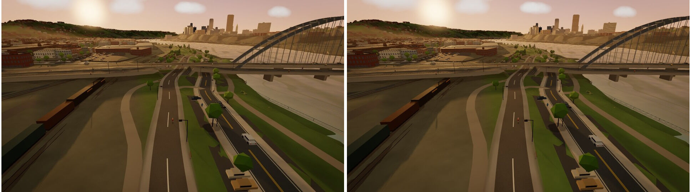
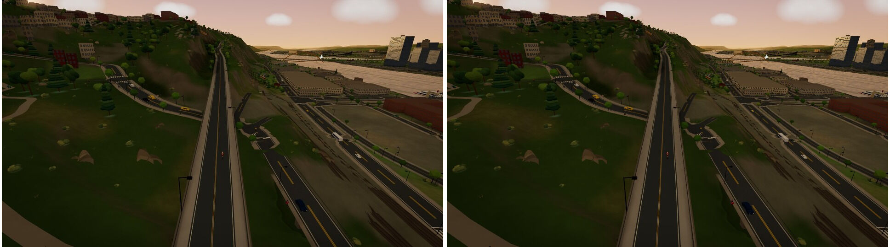
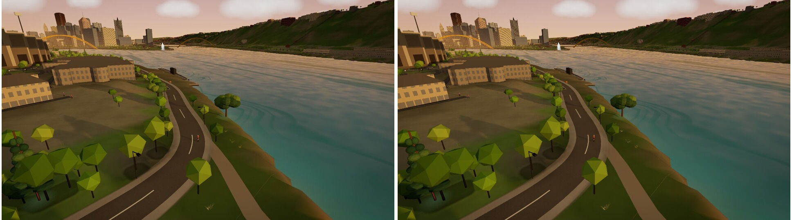
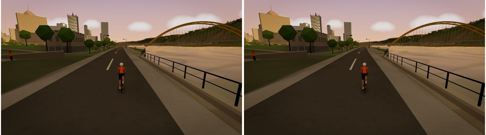

# W2 · budget (item #1): draw calls at every Pittsburgh spot

Branch `w2-budget`. Wave-2 agent for item #1 of `OPEN.md`: every spot under 600 draw calls on Balanced and
High, with headroom (≤ 520) for the street & facade kit to go route-wide.

## Where the calls went

`npm run snap -- --breakdown` now counts the frame's real draw calls and triangles by object (it wraps
`renderBufferDirect` for the one frame; shadow-pass calls are marked `shadow:`). Before, at 8.8 km
(695 calls, 1.86 M triangles):

| calls | triangles | what |
| --- | --- | --- |
| 149 | 137 k | `Buildings` (one mesh per 320 m chunk) |
| 77 | 8 k | rooftop details (a second mesh per chunk, solid material) |
| 72 | 360 k | `Street trees` (one instanced mesh per 480 m tile) |
| 70 / 69 / 47 | 198 / 103 / 17 k | `Streets` / `Sidewalks` / `Paths` (per 512 m tile) |
| 51 | 266 k | lamp posts (per 640 m tile) |
| 11 | 492 k | `Ground` (terrain) |
| 19 + 9 + 3 | 219 k | street kit (South Side) |
| ~20 | | the shadow pass: only moving things since the bake |

Every chunk of the city is built for the bake, and the camera sees kilometres of it, so the per-tile meshes
added up: 535 of the 695 calls were city tiles, most of them more than a kilometre away.

## What changed (`js/world/city.js`, tag `[w2-budget]`)

| | was | now |
| --- | --- | --- |
| Buildings | a mesh per 320 m chunk + a rooftop-detail mesh per chunk | one mesh per **960 m sector** (3 × 3 chunks), rooftop details folded in |
| Streets, sidewalks, paths (and junction surfaces) | per 512 m tile | per sector |
| Street trees | per 480 m tile | per sector; trunk without its hidden cap (35 → 30 triangles) |
| Lamp posts, glows, pools | per 640 m tile | per sector; **posts drawn only within 600 m** of their sector (420 Light, 800 High) |

- **Streaming is unchanged:** buildings still build per 320 m chunk, nearest first, within the frame budget.
  When a sector's last chunk is built, its chunk meshes are merged into the sector's one mesh
  (`mergeGeometries`, 32-bit index when needed) and the chunk geometries are freed. That happens in the same
  frame the last chunk lands, so the bake (which re-runs when the static set changes) runs once, not twice.
  The bake waits for streaming to finish, so a baked scene always has merged sectors.
- **Rooftop details** (PPG Place's spires, the Gulf Tower's pyramid, masts, tanks, chimneys) are drawn by the
  building material with `aBld.w = 1` (no windows) instead of the solid material: same colours, a touch less
  metalness, no visible difference.
- **Lamp posts** are thin, so the bake leaves them out (`userData.bake = false` now says so explicitly): their
  distance LOD never triggers a re-bake. They are switched by **layer**, not `.visible`, so tools that index
  the scene (the clipping QC) still see every post. The glows and light pools stay at every distance (night).
- No near/far swap and no second "far city" copy: buildings are cheap in triangles (137 k of 1.86 M at
  8.8 km), so one permanent merged mesh per sector does the job without doubling geometry memory, and the
  bake's occluder set stays the meshes that are drawn. Windows were already procedural in the building shader.
- Named for the breakdown: `Lamp posts` (the clipping QC's label), `Lamp glows`, `Lamp pools`.

**Cost:** coarser culling draws a few more triangles at some spots (a sector behind the camera is drawn whole):
up to +0.1 M at 10.7 km; the worst spot drops from 1.86 M to 1.66 M (lamp posts and trees).

## Numbers

Balanced, golden hour, every chunk built and baked (`npm run snap`, software GPU). *Before* = the integrated
branch (`/home/claude/after/snapshots.json`, `d6d65d5`), 2.0 km chase from the same commit; *after* = `w2-budget`.

| spot (m) | draw calls | triangles |
| --- | --- | --- |
TABLE

**High** at the worst spots:

HIGH

NIGHT

## Pictures

Before | after, Balanced, golden hour (960 × 540):

| | |
| --- | --- |
| 8.8 km |  |
| 12.0 km |  |
| 17.3 km |  |
| 2.0 km chase |  |

Pixel diff of the 2.0 km chase pair: mean 0.7 / 255, only the animated water, the road's random grain and the
people differ.

## QC

QC

## How-to

- `SECTOR` (exported from `city.js`, 3 = 960 m): the merge unit for every static city mesh. Bigger sectors mean
  fewer calls but coarser culling (more triangles behind the camera).
- `LAMP_LOD` (`city.js`): how far from the camera lamp posts are drawn, per quality.
- `mergeGeometries(list)` (exported from `city.js`): concatenates same-attribute geometries into one indexed
  geometry; reuse it for other per-chunk meshes.
- Anything added per chunk that is static and seen from far should go into the sector mesh (or its own
  per-sector mesh), not a mesh per chunk. Anything that comes and goes with distance should be thin or
  `userData.bake = false`, and preferably switched by layer, so it neither re-bakes nor hides from QC.
- `npm run snap -- --breakdown <spots>` lists the real calls and triangles per object name (digits → `#`).

## What's left

- **Street kit:** its meshes are still per 320 m chunk (`Sidewalks · kit` has no distance LOD: 19–27 calls at
  the South Side spots). Route-wide it adds about 46–54 calls, which fits (worst spot now 285); merging the
  kit's walks per sector in `street-kit.js` would take most of that back.
- `Ground` (terrain) is the largest triangle cost left (≈ 0.4–0.5 M at the worst spots), owned by the far
  ground mesh.
- Frame times and the merge's cost while riding need the M4 (**I** overlay); on this VM a sector merge is a
  few milliseconds inside the 7 ms streaming slice.
