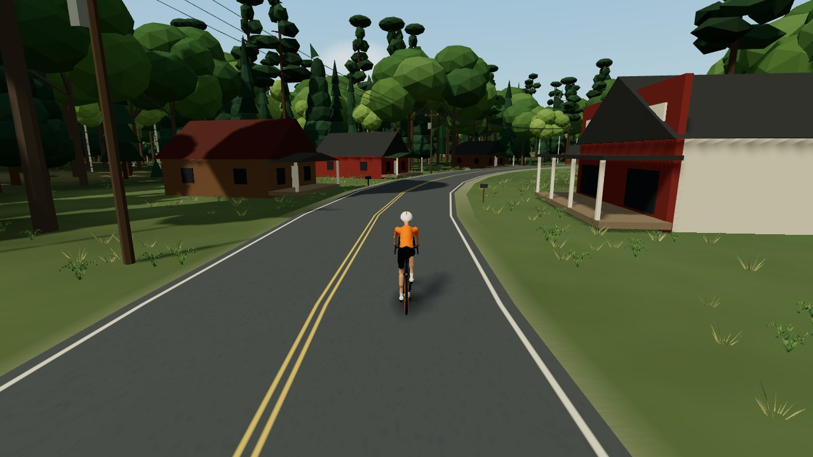
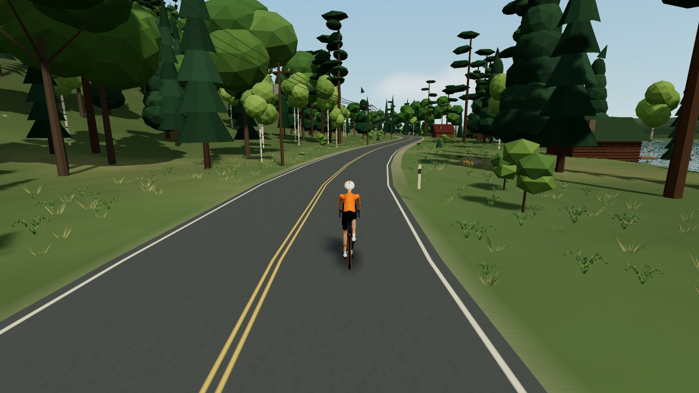
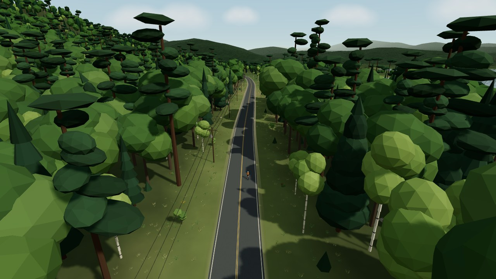
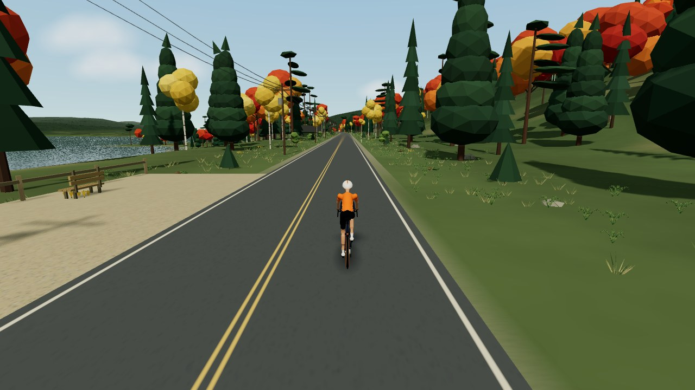
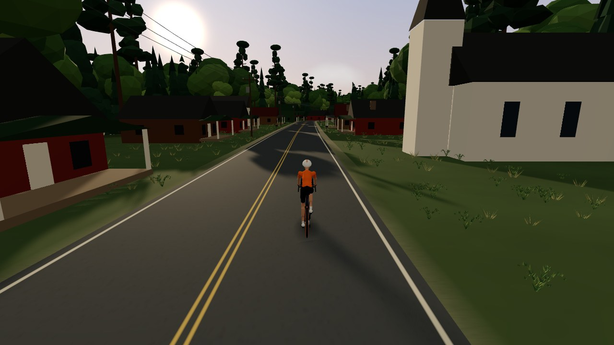
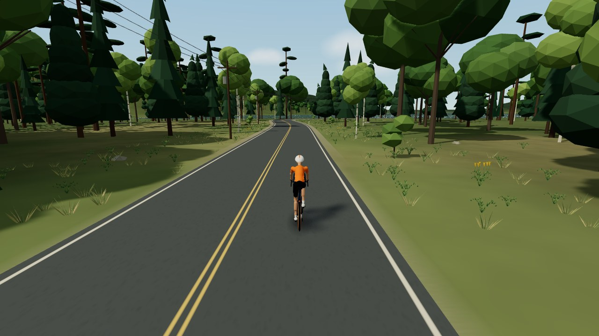
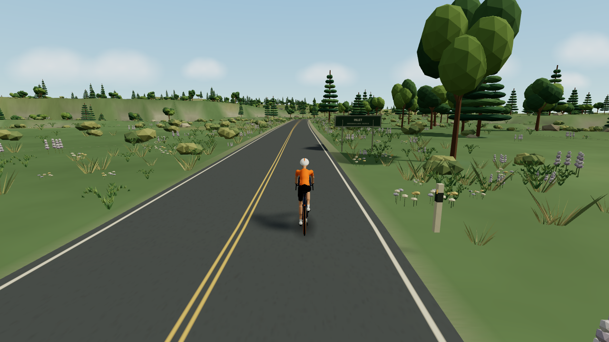

# Route 28 · Old Forge to Eighth Lake — scenery review (v2)

## Built on `route28-test` (all phases, one pass)

| Old Forge (0.5 km) | Fourth Lake glimpse (10.7 km) |
| --- | --- |
|  |  |
| **Over the forest near Eagle Bay (drone, 16.2 km)** | **Seventh Lake lookout, fall palette (24.5 km)** |
|  |  |
| **Inlet, morning (19.1 km)** | **Eighth Lake ahead at the turnaround (29.1 km)** |
|  |  |

*Rendered with a software GPU in headless Chrome, so shadows and colours are close to what you'll see, but frame rate isn't.*

- **Phase 0, road:** waypoint 2 moved to Eagle Bay on NY-28 and the route rebuilt. It now runs 29.2 km each way, within 20 m of Old Forge, Eagle Bay and Eighth Lake. All signs, the lookout and the towns were re-placed for the new distances.
- **Phase 1, real water and terrain:** `tools/build_scene_terrain.py` bakes the USGS elevation on a 30 m grid. Lakes are found from the elevation itself, because hydro-flattened water is exactly flat. The results:
  - Fourth Lake is 792 ha at 520.3 m; First to Third Lake is 401 ha at 520.4 m; Sixth and Seventh Lake together are 299 ha at 544.5 m; Eighth Lake is 124 ha at 545.3 m.
  - Lakes are drawn on that grid as sheltered water, with no surf.
  - Within about 2.6 km of the road, the ground follows the real hills.
  - New QC checks: `road-in-lake`, `lake-side`, `building-on-road`, `building-in-water` and `dock-on-land`. All pass.
  - I didn't need an OpenStreetMap download.
- **Phase 2, forest:**
  - A procedural kit with white pine, spruce, hemlock, maple and birch at three detail levels.
  - Forest-edge bands: mown verge, then brush, then a dense stand of about 180 trees/ha.
  - Nested near, mid and far tiers, so trees never jump when detail changes.
  - Tiles are built a few per frame, nearest first.
  - A canopy shell covers the hills beyond the last trees.
  - Ground cover is smaller and is now grass, fern, goldenrod and blueberry.
  - The woods thin out toward nearby shores, so you get lake glimpses.
- **Phase 3, atmosphere:**
  - Fog is set per scene (700 m to 9 km).
  - The lake water is tea-coloured with wind ripples, a reflection of the treeline and sun glint.
  - Mist lies on the lakes at morning and golden hour.
  - The real-horizon tint is darkened to forest green.
- **Phase 4, towns:**
  - Old Forge, Eagle Bay and Inlet have houses, a store, a church and a motel.
  - About 70 lakeside camps, each with a driveway and mailbox, a dock or boathouse, and canoes.
  - Boats on the water, utility poles with sagging wires, and guardrail above water or drops.
  - Signs: brown-and-yellow DEC, and yellow diamond deer warnings.
- **Phase 5, polish:** `season: "fall"` (or `&season=fall` in the preview) switches maples to red and orange and birches to gold.
- **Load (headless count, Balanced):** about 360–460 draw calls and 1.0–1.9M triangles. This still needs measuring on the M4 Air.

**Not done or still open:**
- The logarithmic depth buffer is unchanged; check frame rate on the Air before changing it.
- Lake names come from position matching:
  - The two upper lakes are one connected flat area, so they're labelled "Sixth and Seventh Lake".
  - Smaller ponds are unnamed.
- There's no Bald Mountain fire tower or Water Safari landmark yet.

---

Test branch: `route28-test`. Scene: `routes/scenes/route28.json`. GPX: `routes/parks/route28.gpx` (28.6 km out, then back). Routing: `routes/catalog.json` → `route28`.

v2 adds an independent advisor pass. Every number was re-measured against the GPX and code. Geography from memory is marked with a confidence level and should get a quick map check on the Mac, because map data can't be reached from the cloud workspace.



*At the Inlet sign: open meadow, lupine, knee-to-waist-high flowers, sparse ornamental-looking trees. No village, no lake.*

---

## Part 1 — What's wrong

### 1. Most of the GPX is on the wrong road (≈90% confidence)
- **Cause:** waypoint 2 in `catalog.json` is `[43.7585, -74.826]`. That's about 1 km south of Eagle Bay (≈43.768, −74.818), in or beside Fourth Lake, so BRouter snapped it to **South Shore Road**.
- **Evidence from the track:**
  - It leaves Old Forge heading south, then east, where Route 28 heads north-east.
  - It dips to 43.703° N at 4.5 km (south of First Lake).
  - At Eagle Bay's longitude it is 1.9 km south of the hamlet.
  - It enters Inlet from the south-west.
- **What's still right:** Inlet → Eighth Lake (18.4–28.6 km) is consistent with Route 28. The last ~0.9 km turns off toward the Eighth Lake campground (medium confidence).
- **Decision needed:** move waypoint 2 to Eagle Bay on NY-28 (≈`[43.7686, -74.8181]`, verify on a map) and rebuild. The alternative is to keep South Shore Road, which is the quieter real-world bike ride, and rename the route. The two options get different art (see Part 3).

### 2. The lakes are in the wrong places (measured)
| Lake | Measured problem |
| --- | --- |
| **Second** | Road inside the ellipse from 10.5 to 11.5 km (290 m from centre), so it reads as a causeway. |
| **Seventh** | Road inside the ellipse from 21.4 to 22.3 km, 12–20 m above the water. |
| **Eighth** | Road inside the ellipse for the **last 1.7 km**, with the turnaround 21 m from the centre. |
| **First** | The 170 m gap is fine, but the terrain carve band reaches the road from 7.4 to 8.4 km. |
| **Fourth** | 3.8 × 1.3 km ellipse. The real lake is about 9 km long, narrow, with wooded islands. |
| **Missing** | Old Forge Pond, Third Lake, Fifth Lake. |

- **Water levels are too high.** First through Fifth Lake are one pool at about 520 m. The scene puts them at 527–535 m, 7–15 m too high. The road on the lower chain is 6–26 m **above** the water, not level with it. Sixth/Seventh (≈544 m) and Eighth (≈546 m) are close.
- **The Seventh Lake lookout, rail and sign face away from the lake.** They use `side: "ocean"`, which is the right-hand side, but the lake is on the left heading out.

### 3. Trees are too sparse and the wrong scale (measured)
- **Density:** about **15 trees/ha** on Balanced, peaking at ~28/ha inside groves. The 230 candidates × 1.15 per tile give 72 candidates/ha, and 21% of them become trees. That's parkland.
- **Range:** trees stop 576–768 m from the camera (a 7 × 7 tile block).
- **Scale:** `broadleaf` is 9–11 m tall and almost as wide, about half a real canopy. That's the main tree-scale error. `fir` is 14–17 m.
- **Ground cover is just as damaging as tree scale:**
  - Flowers grow to ~1.2 m and grass tufts to ~1.6 m.
  - `rock*` reaches 5 m, so boulders show up everywhere.
  - The species are western and alpine: lupine and alpine flowers.

### 4. Mountains are soft bumps
- `reliefM: 45` gives gentle 2–3 km swells.
- When online, the ground morphs toward real elevation between 500 m and 1.3 km. Inside 500 m, and everywhere when offline, it stays nearly flat.
- Real hills rise **130–225 m** above the lakes (Bald/Rondaxe ~716 m, Black Bear ~744 m, Rocky ~678 m, lake 520 m). They're rounded and forested to the top, with occasional grey ledges.
- The **600 m–1.5 km band has neither trees nor aerial imagery**. That's the "bald hills" look.

### 5. No towns or roadside objects
- The kit has no buildings, docks, boats, poles, mailboxes, or proper guardrails (the current rails are plain boxes).
- The Inlet sign sits about 300–400 m past where the village centre probably is (≈18.0 km; low-medium confidence).

### 6. Nothing changes as you ride
Real Route 28 alternates between a forest tunnel, sudden lake openings, and villages. The current scene is uniform meadow from end to end.

### 7. Problems the first pass missed
- **Trees don't follow the terrain morph.** Trees are placed at stylized height, but beyond 500 m the ground morphs toward real height. Today that hides as sparse trees. With a longer tree range, trees would visibly float or sink by about 16 m.
- **The water shader is an ocean shader.** It draws breaking foam within 48 m of shore and a permanent foam line. Shallows default to tropical turquoise (`#79beb1`). The reflection is sky only, with no dark treeline band.
- **Lake discs overlap the real terrain.** They stay visible past the 1.5 km hand-off and float 7–15 m above the aerial photo of the real lake.
- **Colour seam at the hand-off.** Real imagery is dark conifer green, tinted only 38% toward a light meadow green. Expect a visible brightness seam.
- **Fog is hard-coded.** It's linear from 2.3 to 16.5 km, with no per-scene setting. Humid Adirondack air should separate ridges at 1–5 km.
- **Code traps for new assets:**
  - `scenery-assets.js` has a hard-coded list of ground-cover names. New cover not on it gets single-sided faces and no wind.
  - The `castShadow` regex only matches `cypress|pine|fir|broadleaf|palm|rock|outcrop`. `whitepine`, `spruce` and the other new species wouldn't cast shadows.
  - Trees need `inland > 65`. Shrubs take 37% of candidates and rocks 12%.

### 8. Performance risks for a dense forest (estimates, not yet measured)
- **Current load:** about 3M triangles and ~500 draw calls (≈10 instanced meshes × 49 tiles).
- **Naive density increase:** going to 150–250 trees/ha with today's two LOD levels would cost 10–15M triangles. That isn't viable, so a three-tier scheme is required.
- **Overdraw:** `logarithmicDepthBuffer: true` (`world.js:49`) writes fragment depth, which disables early-Z. Every overlapping tree fragment then runs the full standard material with shadow lookups. **This is the biggest risk; measure it first.** Options: test `reversedDepthBuffer`, and use Lambert material for the mid and far tiers.
- **Shadows:** every tree and rock casts. Limit casting to trees within ~60 m of the road and fake the forest-floor shade in the ground colour.
- **Hitching:** `_makeScatter` is synchronous and builds up to 7 tiles at once. Queue tile builds (one per frame, ~4 ms each) and make the water lookup O(1) with a raster mask.

---

## Part 2 — Plan

Order is impact per effort. Effort is in focused working days. **0 → 1 → 2 → 3 → 4 → 5**; Phase 3 can come any time after Phase 1. Don't author any `atM` values until Phase 0 is settled.

### Phase 0 — Decide the road and measure a baseline *(0.5 day, blocks everything)*
- Move waypoint 2 in `catalog.json`, or rename the route.
- Rebuild on the Mac: `python3 tools/build_park_routes.py route28`.
- Re-derive every scene `atM` from `routing.pois`, and add `Old Forge` and `Eagle Bay` POIs.
- Record a baseline on the M4 Air at 0, 10, 18.4 and 21.8 km: frame time, `renderer.info.render.calls` and `.triangles`. Add a debug overlay line if there isn't one.
- **Accept when:** the track is within 30 m of the chosen road on a map overlay.

### Phase 1 — Real water and real near terrain *(3–4 days; fixes "where are the lakes")*
**Files**
- `tools/build_park_routes.py`: add `--water` (OSM via Overpass, run on the Mac or in CI) → `routes/scenes/route28.water.json`. Add `--dem` (bake from the AWS terrain tiles the builder already samples) → `routes/scenes/route28.dem.bin`.
- `regional-landscape.js`: polygon lakes, a raster water mask, and the baked DEM in `baseHeight`. Keep `formations` only as a fallback for scenes without a DEM. Authored hills would otherwise pop against the real-terrain morph.
- `stylized-terrain.js` `_makeOcean`: one `ShapeGeometry` per lake, with an `aShore` (metres to shore) vertex attribute and a proper bounding radius for `_cullFar`.
- `coastal-materials.js`: a lake branch in the water shader.

**Config**
```json
"water": { "file": "routes/scenes/route28.water.json", "style": "lake", "shallowWater": "#6b6a45", "foam": false },
"dem":   { "file": "routes/scenes/route28.dem.bin", "cellM": 30, "corridorM": 2500 },
"palette": { "water": "#2f4a4a", "shallowWater": "#6b6a45" }
```
`route28.water.json` holds `{ "lakes": [ { "name", "elevationM", "outline": [[lat, lon], …], "islands": [ { "name", "outline" } ] } ] }`.

**Details**
- Simplify outlines to 15–20 m. Keep the whole chain under 1,500 vertices (Fourth Lake ≈500).
- Take each lake's `elevationM` from the DEM median inside its polygon.
- **Water mask:** 16 m cells, signed distance stored as Int16, about 1.4 MB. `isWater`, `waterLevelAt` and the terrain carve all read it.
- **Carve depth:** `clamp(inside × 0.15, 0, 12)`, so the shallows show.
- **DEM bake:** 30 m cells within 2.5 km of the route, about 0.5 MB. Blend it in beyond 110 m from the road. This also fixes the floating and sinking trees (Part 1 §7).
- Lift the water mesh 0.3 m above the real lake surface so it lines up with the aerial imagery without z-fighting.

**QC (`tools/qc_course.mjs`) and tests**
- `road-in-lake` (fail): the centreline is inside water outside `bridgeRanges`.
- `lake-level` (warn): a lake's level is more than 3 m off the DEM median.
- `lake-side` (warn): a sign, lookout or rail faces away from water within 400 m.
- `lake-visible` (info): km ranges where the shore is within 150 m, used to place openings.
- Unit test: point-in-polygon and signed distance on a concave outline with an island.

**Accept when**
- QC reports zero `road-in-lake` and zero `road-flooded`.
- At the 28.5 km turnaround the shoreline is ahead, not water all round.
- The water is on the correct side at every `lake-visible` range.
- From a vista above Inlet, Fourth Lake's east end is a recognisable tapering bay that lines up with the aerial imagery to within ~30 m.

**Risks:** OSM inner rings (islands); the fetch can't run in the cloud workspace.

### Phase 2 — Forest *(4–6 days; fixes feel and scale; depends on the Phase 1 DEM)*
**New kit assets** (`tools/build_regional_assets.py`; tree instance scale 0.85–1.15)

| Asset | Height | Crown | Near tris | Mid tris | Look |
| --- | --- | --- | --- | --- | --- |
| `whitepine0/1` | 28, 33 m | 9–11 m | 900 | 90 | Bare trunk for the lower 55%, 5–6 irregular flat tiers, ragged top |
| `spruce0/1` | 18, 22 m | 4–5 m | 600 | 60 | Narrow dark spire, `#23402f`–`#335240` |
| `hemlock0` | 20 m | 7 m | 700 | 70 | Drooping tiers, soft top |
| `maple0/1` | 20, 23 m | 10–12 m | 800 | 80 | Clear trunk to 8 m, 3–4 merged lobes |
| `birch0/1` | 15, 18 m | 5–6 m | 500 | 50 | White trunk `#e6e2d3` with dark bands, light crown |
| `sapling0`, `fernbed`, `goldenrod`, `blueberry` | 2.5 / 0.5 / 0.9 / 0.3 m | | 40–90 | | Edge band only |
| `boulder0/1` | 1.2, 2.0 m | | 30 | | Replace `rock*`, at scale 0.7–1.3 |

- **Far tier:** two crossed quads per tree (4 tris), using one 512 × 256 alpha-tested atlas rendered by the Blender script.
- **Species mix:** maple-type 45%, spruce 20%, birch 13%, hemlock 12%, white pine 10%. Use more spruce and hemlock within 150 m of water.

**Placement** (new forest branch in `_makeScatter`)
- Replace random candidates with a jittered grid (7 m cells near, 9 m mid), so the crowns touch.
- Add a shared `forestMask(x, z)`: 0 on the road strip, water, towns, clearings and lake openings; 1 elsewhere.
- **Bands by distance from the road:**
  - 0–5.5 m: shoulder
  - 5.5–9 m: mown grass
  - 9–13 m: saplings, fern, goldenrod, birch
  - beyond 13 m: full forest
- **Tiers by distance from the camera:**
  - under 120 m: near meshes, about 180/ha
  - 120–400 m: mid meshes, about 120/ha
  - 400–700 m: crossed quads
- **Canopy shell from 300 m to the hand-off:** the ground vertex shader lifts vertices by `forestMask × (16 + 4·noise)` and colours them with canopy-green mottling. It adds no draw calls and follows the terrain morph automatically. This fills the bald band.
- Inside the forest, keep 30% of today's ground cover (ferns and moss only) on a `#3f4a33` floor.

**Config**
```json
"vegetation": {
  "layout": "forest-edge",
  "species": { "maple": 0.45, "spruce": 0.2, "hemlock": 0.12, "birch": 0.13, "whitepine": 0.1 },
  "densityPerHa": { "near": 180, "mid": 120, "far": 90 },
  "edge": { "mownM": 9, "shrubM": 13 },
  "canopyM": 16,
  "cover": ["fern", "fern", "grass", "goldenrod", "blueberry"],
  "coverScale": [0.8, 1.2],
  "clearings": []
},
"palette": { "grass": "#56704a", "meadow": "#7f8a55", "forestFloor": "#3f4a33", "canopy": "#2f4a36" }
```

**Code outside placement**
- `scenery-assets.js`: read `"category": "groundcover"` from the asset JSON instead of the name list. Use Lambert material for the mid tier.
- `stylized-terrain.js`: set shadow casting with a per-tier flag instead of the name regex, and add the tile build queue.
- `COASTAL_QUALITY`: add `treeNearM`, `treeMidM`, `treeFarM` (low 80/250/0, balanced 120/400/700, high 160/500/900).

**Budget (Balanced)**
- Near: ≈0.45M triangles. Mid: ≈0.25M. Far: ≈24k. Edge and cover: ≈0.6M.
- Total scenery should stay **under 2M triangles, which is less than today**.
- Stay under 600 draw calls, hold 60 fps at 1.5× pixel ratio on the M4 Air, and never exceed 25 ms per frame at tile edges.

**QC and tests**
- `tree-on-road` (fail): a near trunk within 6.5 m of the centreline.
- `forest-density` (info): trees/ha in the 13–60 m band, per km.
- Deterministic placement test across quality tiers.
- Screenshot regression at fixed km using `tools/world-preview.html`.

**Accept when**
- **Forest stretches (e.g. 20.0 and 25.0 km):**
  - No horizon shows below treetop height, and the sky is a strip above the road.
  - The first two rows show trunks, and white pines break the canopy line.
  - The rider is about one-tenth of the canopy height.
- **Lake openings:** the far shore is a continuous dark tree band with no bare ground from 600 m to 1.5 km.
- **Ground cover:** no flower or tuft is above the rider's knee.

**Risks:** log-depth overdraw (fall back to lower near density); alpha edges at 1.5×; the canopy-shell edge showing on slopes that face the camera.

### Phase 3 — Atmosphere and lake look *(1–1.5 days; cheap, big effect)*
```json
"atmosphere": { "fogNearM": 500, "fogFarM": 9000, "fogFarRealM": 14000, "defaultTime": "morning", "lakeMist": 0.35 }
```
- `world.js` reads `scene.atmosphere` when it creates the fog and when the far terrain switches on.
- The lake water style has:
  - no breakers, and a soft 1 m shore line
  - small wind ripples
  - darker tea-coloured water
  - a dark treeline band in the reflection near the horizon
- Mist is one fog-coloured transparent plane 2 m above each lake, shown at morning and golden hour only.
- **Accept when:** from a lake opening at the morning preset you see three depth layers (near trees, far shore, hills), each lighter than the one in front. No foam animation anywhere.

### Phase 4 — Towns, camps, roadside *(5–7 days; needs the Phase 1 water mask and the Phase 2 forest mask)*
**Assets** (Blender, vertex colour)

| Asset | Size | Tris |
| --- | --- | --- |
| `house0-3` | 8 × 10 m footprint, 6–7.5 m ridge | 150–250 |
| `store0` (false front) | 12 × 9 m | 250 |
| `church0` | steeple to 18 m | 300 |
| `motel0` | 24 × 7 m | 200 |
| `camp0-2` (dark brown or green cabins) | 6 × 8 m | 120–180 |
| `boathouse0` | 5 × 9 m | 150 |
| `dock0` | 2 × 10 m | 40 |
| `canoe0` | 5 m | 60 |
| `motorboat0` | 5.5 m | 120 |
| `pole0` | 9 m | 30 |
| `mailbox0` | | 20 |

Also needed: a box-beam `guardrail` to replace the current boxes, plus `sign-curve`, `sign-deer` and `sign-dec` (brown with yellow lettering). Wires are a two-strand ribbon per town between poles.

**Config**
```json
"towns": [
  { "name": "Old Forge", "fromM": 0, "toM": 1500, "style": "village", "setbackM": [12, 22], "spacingM": [14, 28], "sidewalk": true, "speedSign": 30 },
  { "name": "Inlet", "fromM": 17700, "toM": 18700, "style": "village" }
],
"camps": [ { "fromM": 8500, "toM": 17500, "side": "lake", "spacingM": [60, 150], "dock": true } ],
"poles": { "spacingM": 45, "side": "left", "skip": [] }
```
(The `atM`, `fromM` and `toM` values are for the current GPX and change after Phase 0.)

**Placement**
- New `js/world/toolbox/structures/settlement.js` module, modelled on `CoastalDetails`: instanced and built once per route.
- `forestMask` is 0 inside towns out to the setback plus 40 m. Lawns use `palette.meadow`.
- Camps go only where the shore is within 120 m on the lake side. Each gets a driveway gap in the tree wall and a mailbox at the road.

**QC**
- `building-on-road` (fail): a footprint within 8 m of the centreline.
- `building-in-water` (fail).
- `dock-on-land` (warn).

**Accept when**
- **At 0.2 km:** buildings on both sides, poles and wires, sidewalk, at least 12 buildings in frame.
- **Inlet centre:** village on both sides, with Fourth Lake visible through a gap on the lake side.
- **Along camp ranges:** a driveway or camp glimpse at least every 150 m, and a dock wherever water shows.

**Risk:** buildings are the first non-organic assets, and proportion errors show quickly. Keep them simple and consistent.

### Phase 5 — Life and polish *(2–3 days, optional)*
- Drifting canoes and motorboats on the lake polygons, and an occasional loon.
- A Bald Mountain fire tower if the route goes via Eagle Bay.
- `season: "fall"` through per-instance `setColorAt` on maples and birches, which the instancing already supports.
- Occasional cars and other cyclists.

---

## Part 3 — Fulton Chain reference

### Current track (South Shore Road, then Route 28)
- **0.0 km:** Old Forge centre on Main St (high confidence). Old Forge Pond and the dam are just north-east.
- **4.0–6.5 km:** the only real climb, 528 → 561 m, in forest south of First Lake (identification medium).
- **6.5–18 km:** rolling along the south side of Second, Third and Fourth Lake (high). The road is mostly 50–300 m back from the water behind private camps. **Model the lake as glimpses down driveways, not open shore.**
- **≈18.0 km:** Inlet centre, at the east end of Fourth Lake (medium on the exact km).
- **18.5–20 km:** a ~25 m climb toward Sixth Lake.
- **21–23 km:** Seventh Lake on the left heading out, with the road 10–20 m above the water (medium-high). There's a state boat launch along here (exact km uncertain).
- **27.7 km:** the turn toward the Eighth Lake campground. 28.6 km is at the south shore of Eighth Lake (medium).

### If rebuilt via Eagle Bay (km values unknown until rebuilt)
- **Old Forge north end:** a water park with a large Paul Bunyan figure on the highway (high).
- **Between Old Forge and Eagle Bay:** Bald Mountain (Rondaxe) fire tower, ~716 m, north of the road, with its trailhead on Rondaxe Road.
- **Eagle Bay:** the Big Moose Road junction; a small hamlet on Fourth Lake's north shore (high).
- **Eagle Bay → Inlet:** Rocky Mountain and Black Bear Mountain share a trailhead on the north side, and the Herkimer/Hamilton county line is here (medium-high). This side has more open Fourth Lake views (medium).

### General look
- **Lake levels:** the lower chain (Old Forge Pond, First to Fifth) is one level. Sixth and Seventh are ≈24 m higher, and Eighth is slightly higher again.
- **Fourth Lake** is long and narrow with wooded islands (Alger, Cedar, Dollar; positions uncertain). Fifth Lake is a small pond behind Inlet.
- **Hills:** low, rounded, fully forested, 130–225 m above the water, with occasional grey ledges. No bare summits.
- **Forest:** sugar maple, beech and yellow birch, with red spruce, balsam fir, hemlock and tall shoreline white pines. Paper birch at the edges.
- **Buildings and signs:** camps are dark brown or green with white or red trim, and boathouses sit at the waterline. DEC signs are brown with yellow lettering.
- **Don't place without checking:**
  - the seaplane base on Seventh Lake
  - the Shoal Point lighthouse on Fourth Lake
  - the Cathedral Pines trailhead
  - McCauley Mountain's bearing from the first kilometres
