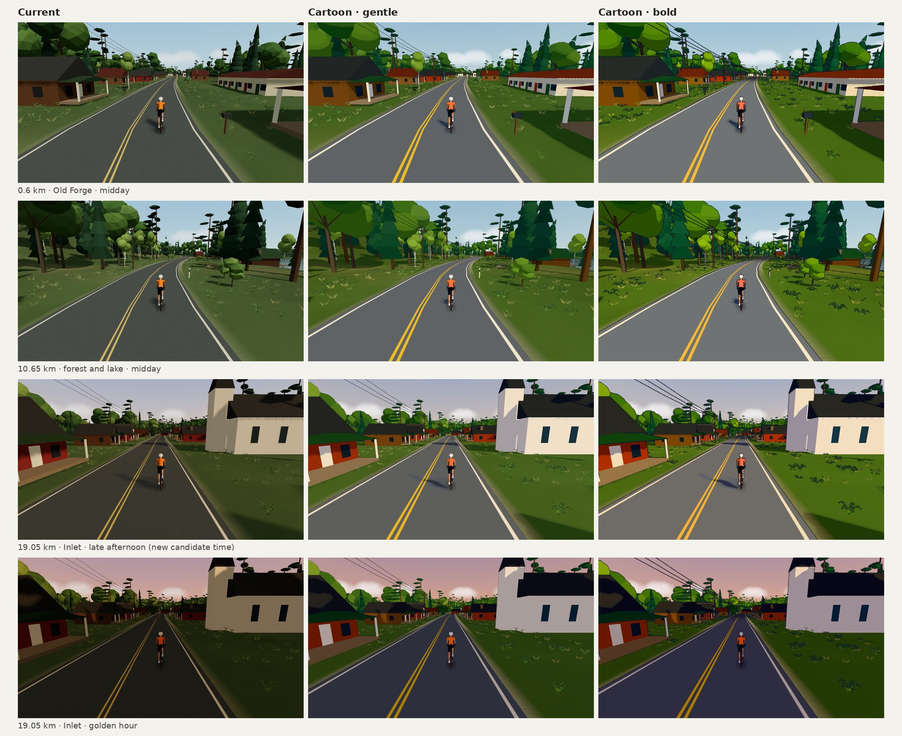

# Route 28 look test: current vs cartoon gentle vs cartoon bold

16 Nov 2026, branch `route28-cartoon`. Rendered headlessly with `npm run snap` (software GPU, Balanced detail, chase camera).

| Row | Spot | Time |
| --- | --- | --- |
| 1 | 0.6 km, Old Forge | midday (the route's current default) |
| 2 | 10.65 km, forest and lake | midday |
| 3 | 19.05 km, Inlet | late afternoon: a new candidate signature time, with the sun at 24° |
| 4 | 19.05 km, Inlet | golden hour, with the sun at 7° |

## What the two looks change
Both looks are layered over today's scenery by `js/world/look.js`. Nothing is rebuilt or batched yet, so draw calls are unchanged.

| | Gentle | Bold |
| --- | --- | --- |
| Shading | 3 soft bands from direct sun | 3 hard bands |
| Colour grade | saturation ×1.14, value ×1.07 | saturation ×1.38, value ×1.12 |
| Shadows | cool lavender, 28% darker than mid | cool blue-violet, 38% darker |
| Outlines | thin and light, near the rider only (160 m) | 1.5 px and strong, out to 240 m |

Both looks also have:
- smooth crowns and rocks, with no colour jitter between facets
- a flat road with clean paint and no grain or bump
- Neutral tone mapping in place of ACES

## Notes
- At golden hour, with the sun at 7°, long shadows cover most of the road, so a cartoon version reads dark navy. Late afternoon keeps the road lit between the trees. It's the suggested signature time for Route 28.
- Shapes aren't exaggerated yet (narrower spruce, rounder maple). That comes with the cartoon kit.
- The rider is unchanged apart from the toon bands. The cartoon rider comes later.

## Try it live
- Preview page: `tools/world-preview.html?park=route28&look=bold`. The Look menu in the panel switches between the looks.
- Snapshots: `npm run snap -- route28@10650:bold route28@19050:afternoon:gentle`
